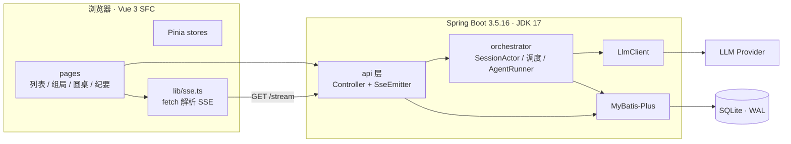

# AI Panel Studio · AI 圆桌讨论 Web App

> 输入一个议题，召集一场由 AI 专家组成、你可以随时插话的圆桌讨论。
> 不是"问一句答一句"，而是**主持人开场 → 专家并行发言 → 相互质疑 → 你加入辩论 → 收敛成纪要**。

    

---

## 1. 这是什么

`AI Panel Studio` 是一个前后端分离的 AI 圆桌讨论应用。

用户输入讨论议题并设定参会规模（默认 4 人：1 位主持人 + 3 位专家），系统调用大模型生成一组立场互补的专家角色（战略顾问 / 行业分析师 / 技术专家 …），用户可以认领其中一个席位加入讨论，也可以纯旁观。讨论由主持人开场并串联，专家之间可以互相反驳，用户可随时打断、追问、质疑。讨论结束后，系统按角色聚合观点，产出一份可溯源的结构化会议纪要并落库。

**它要解决的不是"答案不够好"，而是"答案太单一"**：单 AI 对话只有一个结论，缺少对抗性；多 Agent 圆桌把分歧显式地摆到桌面上，让判断有对比、有出处、可复盘。

## 2. 核心能力

| 能力 | 说明 |
| --- | --- |
| 圆桌大厅 | 正在进行的讨论列表，可旁观、可加入、可发起新议题 |
| 专家生成 | 根据议题实时生成 1 位主持人 + N 位专家，带角色立场与发言风格，流式呈现 |
| 认领席位 | 用户可认领某位专家席位（替换其发言权）或纯旁观 |
| 多轮自由讨论 | 不设轮次上限，主持人开场/串联，专家并行发言，用户随时插话 |
| Agent 行动轨迹 | 实时时间线：谁在思考、谁在发言、谁在等谁，技术细节可折叠 |
| 观点溯源 | 每条观点标注「发言者 + 轮次 + 时间」，可跳回上下文 |
| 会议纪要 | 讨论结束后按角色结构化输出，含分歧点与待验证假设，JSON 落库可复盘 |
| 全程流式 | 单条 SSE 连接多路复用，多 Agent 并行输出互不阻塞，单个 Agent 失败不拖垮全场 |

### 2.1 多 Agent 是怎么协作的

不是"一个大模型演四个角色"，而是**四个独立的 Agent 实例 + 一个显式的调度器**：

1. **席位分工**：生成阶段为每个席位写入互不相同的 `stance`（立场）与 `focus`（关注点），主持人没有立场，只负责推进；专家被要求"先回应再主张，禁止附和"。
2. **主持人调度**：`SpeakerPolicy` 是纯函数，按"被用户点名 > 被引用未回应 > 与用户输入关键词相关 > 久未发言"打分，本回合取 top 2~3；主持人另由调度器触发开场与每两回合收束。
3. **并行发言**：同回合内多个 `AgentRunner` 通过 `CompletableFuture` 并发执行，各自独立 `WebClient` 流与独立 `messageId`，任一路慢都不阻塞其他路；每场 `Semaphore(3)`、全局 `Semaphore(20)` 控制并发上限。
4. **收敛**：所有发言落库后，`MinutesService` 按席位聚合主张、抽取分歧对、标注待验证假设，产出可溯源的六段纪要。

技术细节（时序图、失败隔离矩阵）见 [ARCHITECTURE](docs/ARCHITECTURE.md) §3.2。

### 2.2 三个核心页面（交付截图位置）

| 页面 | 路由 | 交付要求 |
| --- | --- | --- |
| 讨论列表 | `/` | 至少 1 张截图（含进行中/已结束状态、席位头像组） |
| 讨论详情 | `/discussions/:id` | 至少 1 张截图（**必须能看出两路并行流式**） |
| 会议纪要 | `/discussions/:id/minutes` | 至少 1 张截图（六段结构 + 溯源入口） |

截图存放在 `docs/screenshots/`，命名 `01-lobby.png` / `02-live.png` / `03-minutes.png`，并在此处嵌入。

## 3. 技术栈

### 3.1 既定前提（项目强制约束）

| 项 | 版本 | 说明 |
| --- | --- | --- |
| **后端框架** | **Spring Boot 3.5.16** | 基于 Jakarta EE 9+，全量 `jakarta.*` 命名空间 |
| **JDK** | **17（LTS）** | 无虚拟线程（Loom 需 21），线程模型必须显式规划 |
| **前端框架** | **Vue 3.4** | Composition API + `<script setup>` + TypeScript；界面全中文；UI 采用单文件组件 + CSS 设计令牌实现 |
| **数据库** | **SQLite 3.40+** | 作业要求使用 SQLite；单文件、WAL 模式、单写者 |
| 构建 | Maven 3.9（后端） / pnpm 8（前端） | |

> UI 实现：页面按 `pages/` 划分，通用块抽到 `components/`，视觉令牌集中在 `styles/tokens.css`（三色、间距、字号、中文字体栈），主题调整只需改一处。

### 3.2 在此之上补齐的选型

| 层 | 选型 | 为什么是它 |
| --- | --- | --- |
| Web 层 | Spring MVC（Tomcat）+ `SseEmitter` | 数据访问是阻塞式的（MyBatis-Plus + SQLite），MVC 更顺；80 路 SSE 用线程池足够，不必上 WebFlux |
| 实时通道 | SSE，**单连接按 `messageId` 多路复用** | 单向推送足够；比 WebSocket 易调试、易穿透代理 |
| 多 Agent 编排 | **自研** `SessionActor` + `CompletableFuture` + `Semaphore` | 调度正确性是本题评分重点，不交给 Spring AI 黑盒链 |
| 数据访问 | MyBatis-Plus 3.5.12（`mybatis-plus-spring-boot3-starter`）+ HikariCP | SQLite 方言简单可控；`JacksonTypeHandler` 直接映射 JSON 字段 |
| 数据库迁移 | Flyway 11（Boot 3.5 管理版本；`V1__schema.sql` …） | 启动即迁移，重复执行幂等 |
| 参数校验 | Jakarta Validation + 统一 `@RestControllerAdvice` | 错误码与 API 文档一致 |
| 接口文档 | springdoc-openapi 2.x（Swagger UI） | 注解即文档，与 `docs/API.md` 双向对齐 |
| 日志/观测 | Logback + logstash-encoder（JSON）+ MDC + Actuator | `discussionId/agentId` 需跨异步线程传递（`TaskDecorator`） |
| 前端工程 | Vite 5 + Pinia 2 + Vue Router 4 | 构建轻量、热更新快；组件按业务语义拆分（seat/message/trace），样式集中在设计令牌，便于统一调整 |
| 中文 UI | 自研文案层 `lib/copy.ts`（按钮/空态/错误/提示统一口径）+ `format.ts`（"3 分钟前"、`2026-11-17 16:32`） | 界面无英文残留、无中英混排；术语统一（议题/席位/回合/纪要） |
| 无障碍 | 中文 `aria-label`、`aria-live="polite"` 节流播报、键盘可达 | 流式输出不刷屏；读屏用户能听清"谁在说话" |
| 前端流式 | `fetch` + `ReadableStream` 自解析 SSE | `EventSource` 不能自定义请求头（需要 `X-Device-Id`） |
| 测试 | JUnit 5 + MockMvc + WireMock + Playwright | WireMock 注入 LLM 故障；Playwright 跑 3 条 E2E |
| 部署/运行 | **本地原生运行，不使用 Docker**：`mvn spring-boot:run` + `pnpm dev`，或打包成单个 jar | 数据库就是 SQLite 文件，没有需要编排的服务；少一层容器 = 少一层流式代理的坑 |

### 3.3 JDK 17 带来的两个真实约束

1. **没有虚拟线程**：每个 agent 的流式读取占一个平台线程。所以 `agentExecutor`（core 8 / max 16 / queue 200）与 `Semaphore(3)/场`、`Semaphore(20)/全局` 必须显式设计，不能靠 Loom 兜底。
2. **异步线程丢失 MDC**：`SseEmitter` + 线程池会让 `discussionId` 从日志里消失，必须用 `TaskDecorator` 复制 MDC，否则线上排障等于瞎跑。

SQLite 与并发模型带来的约束（单写者、WAL、`busy_timeout`）见 [DATABASE](docs/DATABASE.md) §1 与 [ARCHITECTURE](docs/ARCHITECTURE.md) §3.6。

选型取舍与替代方案（为什么不用 WebFlux / Spring AI / JPA / PostgreSQL）详见 [docs/ARCHITECTURE.md](docs/ARCHITECTURE.md) §4。

### 3.4 架构一览



分层职责、回合调度时序、SSE 多路复用与失败隔离矩阵见 [ARCHITECTURE](docs/ARCHITECTURE.md)。

## 4. 目录结构

```text
ai-panel-studio/
├── AGENTS.md                      # AI 协作约束总纲（红线 / 必做 / 模块地图）
├── rules/                         # 分模块约束：项目边界 · 架构 · 前端视觉 · 接口并发 · 数据测试 · 工作流
├── docs/                          # 设计文档（先于代码）
│   ├── PRD.md                     # 产品需求文档
│   ├── ARCHITECTURE.md            # 架构 + 并发/流式设计
│   ├── DATABASE.md                # 数据库设计 + ER 图
│   ├── API.md                     # 接口契约 + SSE 事件协议
│   ├── TESTING.md                 # E2E 用例与验收清单
│   ├── PROJECT_PLAN.md            # 里程碑 + commit 规划
│   ├── PROMPT_LOG.md              # Prompt / 工具调用留痕
│   └── DELIVERY.md                # 交付清单 / 打包 / 视频分镜 / 提交模板
├── server/                        # Spring Boot 3 · JDK 17 · Maven
│   ├── pom.xml
│   └── src/main/
│       ├── java/com/panelstudio/
│       │   ├── api/               # controller · dto · sse(SseEmitter 注册表) · advice
│       │   ├── application/       # discussion / panel / minutes 用例服务
│       │   ├── orchestrator/      # SessionActor · TurnScheduler · AgentRunner · ContextBuilder
│       │   ├── domain/            # entity · policy(SpeakerPolicy) · statemachine
│       │   ├── infra/             # llm · mapper(MyBatis-Plus) · config · logging
│       │   └── PanelStudioApplication.java
│       └── resources/
│           ├── application.yml
│           ├── db/migration/      # Flyway: V1__schema.sql / V2__indexes.sql / V3__seed.sql
│           └── mapper/            # MyBatis-Plus 自定义 XML（仅复杂聚合）
├── web/                           # Vue 3 · TS · Vite
│   ├── src/
│   │   ├── pages/                 # lobby / panel / live / minutes
│   │   ├── components/            # seat-card · message-bubble · trace-panel · composer · dialog
│   │   ├── stores/                # Pinia: discussion / messages / traces
│   │   ├── lib/                   # api.ts · sse.ts · format.ts · copy.ts（中文文案常量）
│   │   └── styles/                # tokens.css · layout.css · pages/*.css
│   └── vite.config.ts             # /api 代理
├── e2e/                           # Playwright
├── scripts/                       # dev.sh/dev.bat · build.sh/build.bat（纯本机脚本，无容器）
├── data/                          # SQLite 文件（gitignore）
└── README.md
```

> 当前处于 **docs 阶段**：`server/` 与 `web/` 尚未落地。文档先行是为了把"需求拆解 → 契约 → 数据模型"固化，编码严格按契约推进。

## 5. 快速开始（代码落地后可用）

> **不使用 Docker / 容器 / nginx**。数据库是 SQLite 文件，没有需要编排的服务，全部走本机命令与脚本。

前置：JDK 17（`JAVA_HOME` 已配置）、Maven 3.9、Node 20 + pnpm 8。

```bash
cp .env.example .env        # 填 LLM_API_KEY / LLM_BASE_URL（可选 SQLITE_PATH）

# 开发模式：后端 8080 + 前端 5173（Vite 代理 /api）
./scripts/dev.sh            # Windows: scripts\dev.bat
```

等价于手动两条命令：

```bash
mvn -f server/pom.xml spring-boot:run     # 启动即执行 Flyway 迁移
pnpm -C web install && pnpm -C web dev    # http://localhost:5173
```

演示模式（单进程，交付/录视频用这一条）：

```bash
./scripts/build.sh          # 构建 web/dist → 复制到 server 静态目录 → mvn package
java -jar server/target/panel-studio.jar  # http://localhost:8080
```

`application.yml` 已配置 SQLite 连接参数（WAL / `busy_timeout` / `foreign_keys`），无需手工建库 —— 首次启动会在 `data/panel-studio.db` 自动建表并写入演示数据。备份：`sqlite3 data/panel-studio.db "VACUUM INTO 'data/backup.db'"`。

## 6. 文档索引

| 文档 | 你会看到什么 |
| --- | --- |
| [PRD](docs/PRD.md) | 定位、用户与痛点、技术栈约束、功能需求 FR-1~FR-9（含验收标准）、状态机、风险 |
| [架构](docs/ARCHITECTURE.md) | 分层图、回合调度时序、SSE 多路复用、JDK 17 线程模型、失败隔离、选型取舍 |
| [数据库](docs/DATABASE.md) | SQLite 设计取舍、ER 图、7 张表字段字典、索引与 PRAGMA、Flyway 脚本 |
| [API](docs/API.md) | 17 个接口契约、13 类主事件流 SSE 事件 + 4 类组局流事件、错误码 |
| [测试](docs/TESTING.md) | 5 条 E2E + 15 条集成用例、WireMock 故障注入、验收矩阵 |
| [计划](docs/PROJECT_PLAN.md) | 里程碑、WBS、30+ commit 切分方案 |
| [留痕](docs/PROMPT_LOG.md) | Prompt 记录、关键决策、AI 生成 / 人工修改边界 |
| [工作流程](docs/WORKFLOW.md) | 六段开发流程、工具与权限边界、3 个典型问题、效率台账 |
| [交付](docs/DELIVERY.md) | 11 项硬性要求逐条对照、打包结构、视频分镜、邮件模板、评分自检 |

## 7. AI 工具使用说明

本项目在 `CodeBuddy` 内完成，全程保留 Prompt 与工具调用记录（见 [PROMPT_LOG.md](docs/PROMPT_LOG.md)）。原则：

- **约束先行**：仓库根 [AGENTS.md](AGENTS.md) 与 [rules/](rules/) 是写给 AI 的硬性约束（含前端视觉标准、按模块逐步开发、禁止一次性生成整个项目），任何会话开工前必须先读。
- **文档与契约由 AI 起草、人工评审后定稿**；需求取舍、并发模型、失败策略以人工判断为准。
- **代码由 AI 生成后逐文件 Review**，关键路径（`SessionActor` 调度、`SseEmitter` 生命周期、SQLite 事务边界）人工改写并补测试。
- 每份文档与每个模块在 commit message 中标注 `ai-gen` / `ai-gen+human-edit` / `human`。
- **不是一句话生成**：按"文档 → 骨架 → 组局 → 讨论 → 收敛 → 质量"六段推进，每段都有独立的 Prompt 记录与人工修订；PROMPT_LOG 里能看到的是一次次纠偏（如技术栈三次变更、SQLite 单写者应对），而非一次性产出。

## 8. 与作业原文的差异

| 项 | 作业原文 | 本项目 | 理由 |
| --- | --- | --- | --- |
| 后端语言 | 推荐 Node.js + TypeScript | **Spring Boot 3.5.16 + JDK 17** | 推荐非强制；三个考核点与语言无关，JDK 17 无虚拟线程反而更能体现并发调度的工程判断 |
| 数据库 | 未指定 | **SQLite 3.40+（WAL）** | 单文件、零运维、随包复现；单写者代价见 [DATABASE](docs/DATABASE.md) §1.2 |
| 启动方式 | 提到 "Docker Compose 一键起来" | **本地脚本 + 单个 jar**（按项目约定不用容器） | 无独立 DB 服务可编排；少一层代理少一个流式坑 |
| 数量要求 | ≥5 表 / ≥8 API / ≥3 路由 / ≥3 E2E | 7 表 / 17 API / 4 路由 / 5 E2E | 只多不少，且每条需求带验收标准（PRD FR-1~FR-9） |

## 9. 交付与提交

- 必交清单（11 项）逐条对照、压缩包结构、**演示视频分镜**、提交邮件模板、**评分维度自检**：见 [docs/DELIVERY.md](docs/DELIVERY.md)。
- 提交邮箱 `handshake@gaodun.cn`，主题 `【AI开发实习生-姓名-岗位】`，附件含简历 + 作品链接 + 视频链接；截止 72 小时。
- 打包前导出提交历史：`git log --pretty=format:'%h %ad %s' --date=short > docs/git-history.txt`。

## 10. License

MIT
