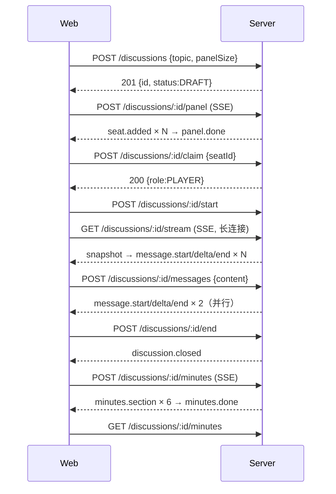

# API 契约 · AI Panel Studio

| 项 | 内容 |
| --- | --- |
| Base URL | `/api` |
| 协议 | HTTP/1.1 + SSE（`text/event-stream`） |
| 编码 | JSON（UTF-8）；SSE 每条 `data:` 为一个 JSON 对象 |
| 身份 | 请求头 `X-Device-Id: <uuid>`（前端首次生成并持久化，服务端据此 upsert `users`） |
| 文档版本 | v1.1（实现栈：Spring Boot 3.5.16 / JDK 17 / SQLite） |
| 路径版本 | v1，路径不带版本号；破坏性变更时升 `/api/v2` |
| 实现 | Spring MVC `@RestController` + `SseEmitter`；DTO 用 `record` + Jakarta Validation；错误统一由 `@RestControllerAdvice` 输出 |
| 在线文档 | springdoc-openapi 2.x → `GET /swagger-ui.html`（与本文档双向对齐，注解即契约） |
| 接口数 | 19（REST 16 + SSE 3），满足 ≥8 的要求 |
| 规模对照 | 支撑 4 个前端路由（`/` `/panel` `/live` `/minutes`）、7 张表；讨论 CRUD / 消息 / SSE 流式 / 汇总四类能力齐全 |

---

## 1. 接口总览

| # | 方法 | 路径 | 用途 | 类型 |
| --- | --- | --- | --- | --- |
| 1 | GET | `/health` | 探活（db / llm / uptime） | JSON |
| 2 | GET | `/discussions` | 圆桌列表（筛选/搜索/分页） | JSON |
| 3 | POST | `/discussions` | 创建圆桌（议题 + 人数） | JSON |
| 4 | GET | `/discussions/:id` | 详情（席位 + 我是否参与） | JSON |
| 5 | DELETE | `/discussions/:id` | 软删除（仅创建者） | JSON |
| 5b | POST | `/discussions/:id/restart` | 同议题再来一场（复制席位配置） | JSON |
| 6 | POST | `/discussions/:id/panel` | 生成席位（流式逐席位返回） | **SSE** |
| 7 | GET | `/discussions/:id/panel` | 查询席位 | JSON |
| 8 | POST | `/discussions/:id/claim` | 认领 / 撤销认领席位 | JSON |
| 9 | POST | `/discussions/:id/start` | 开场，进入 LIVE | JSON |
| 10 | GET | `/discussions/:id/stream` | 讨论主事件流 | **SSE** |
| 11 | POST | `/discussions/:id/messages` | 用户发言 / 插话 | JSON |
| 11b | POST | `/discussions/:id/messages/:messageId/retry` | 单条失败发言重试 | JSON |
| 12 | POST | `/discussions/:id/turns` | 推进一回合 | JSON |
| 13 | POST | `/discussions/:id/end` | 结束讨论 | JSON |
| 14 | POST | `/discussions/:id/minutes` | 生成纪要（流式） | **SSE** |
| 15 | GET | `/discussions/:id/minutes` | 查询纪要（支持版本） | JSON |
| 16 | GET | `/discussions/:id/runs` | 轨迹回放 | JSON |
| 17 | GET | `/metrics` | 轻量指标（延迟/失败率/活跃连接） | JSON |

---

## 2. REST 明细

### 2.1 `POST /discussions` 创建圆桌

```http
POST /api/discussions
X-Device-Id: 7c1f...a9
Content-Type: application/json

{ "topic": "我们该不该把推荐系统从规则引擎换成向量召回", "panelSize": 4 }
```

```json
// 201
{
  "id": "dk_2f8a1c",
  "topic": "我们该不该把推荐系统从规则引擎换成向量召回",
  "status": "DRAFT",
  "panelSize": 4,
  "turnIndex": 0,
  "createdAt": "2026-11-17T08:12:31.000Z"
}
```

校验：`topic` 长度 8–200；`panelSize` 3–6（默认 4）。失败返回 `400 VALIDATION_ERROR` 并带字段级 `details`。

### 2.2 `GET /discussions` 列表

```http
GET /api/discussions?status=LIVE&q=推荐&mine=true&cursor=dk_2f8a1c&limit=20
```

```json
{
  "items": [{
    "id": "dk_2f8a1c",
    "topic": "我们该不该把推荐系统从规则引擎换成向量召回",
    "createdByMe": true,
    "status": "LIVE",
    "panelSize": 4,
    "turnIndex": 3,
    "seats": [
      { "id": "st_1", "name": "沈知远", "title": "主持人", "colorToken": "slate", "status": "ACTIVE" },
      { "id": "st_2", "name": "陈立", "title": "战略顾问", "colorToken": "amber", "status": "REPLACED_BY_USER", "claimedByMe": true }
    ],
    "lastMessage": { "preview": "……所以关键不是模型，而是样本量", "speaker": "陈立", "at": "2026-11-17T08:31:02.000Z" },
    "updatedAt": "2026-11-17T08:31:02.000Z"
  }],
  "nextCursor": null
}
```

- 排序：`LIVE` 优先，再按 `updatedAt` 倒序。
- `q` 走 `LIKE '%'||?||'%'` 模糊匹配议题（SQLite 无 `pg_trgm`；数据量小，全表扫足够；后续可换 FTS5 trigram）；`mine=true` 过滤"我参与的"（需要 `X-Device-Id`，缺失时返回空列表）。
- `status` 支持逗号分隔的集合，便于「进行中」这类分组查询：`status=LIVE,PANEL_READY,SUMMARIZING,INTERRUPTED`；非法取值返回 `400 VALIDATION_ERROR`。
- `cursor` 是**不透明字符串**（内部为偏移量）。排序包含状态优先级，无法用 ULID 做纯 id 游标，因此客户端只回传上一页的 `nextCursor`，不解析内容。
- `createdByMe` 由服务端根据 `X-Device-Id` 解析出的 `userId` 计算：前端据此只向创建者展示「删除」入口，不暴露内部 `userId`。

### 2.2b `DELETE /discussions/:id` 软删除

```http
DELETE /api/discussions/dk_2f8a1c
X-Device-Id: 7c1f...a9
```

```json
// 200
{ "id": "dk_2f8a1c", "deleted": true }
```

- 只写 `deleted_at`，不删数据；列表（`GET /discussions`）不再返回，直链（详情 / 席位 / 讨论流 / 纪要）统一返回 `410 DISCUSSION_DELETED`。
- 仅创建者可删（`createdBy` 与 `X-Device-Id` 解析出的 `userId` 相同），他人返回 `403 FORBIDDEN`；未提供设备头也返回 `403 FORBIDDEN`。
- 删除会同时停掉该场在内存中的调度并关闭其 SSE 连接；重复删除返回 `410 DISCUSSION_DELETED`。

### 2.2c `POST /discussions/:id/restart` 再来一场

```json
// 201：新建一块 DRAFT 圆桌，id 与原场不同
{ "id": "dk_new", "topic": "…", "status": "DRAFT", "panelSize": 4, "turnIndex": 0, "createdAt": "…" }
```

- 复制议题、目标、`topicAnalysis`、`panelSize` 与席位配置（姓名 / 身份 / 立场 / 关注点 / 声线 / 色标）；新席位全部 `ACTIVE`、重新分配 id。
- **不复制**消息、认领记录、纪要与回合进度；新场 `turnIndex=0`、`regenCount=0`、状态 `DRAFT`，需重新生成席位或直接使用复制来的席位开场。
- 原场不存在 / 已删除按统一错误体返回 404 / 410。

### 2.3 `POST /discussions/:id/panel` 生成席位（SSE）

```http
POST /api/discussions/dk_2f8a1c/panel
Accept: text/event-stream, application/json
Content-Type: application/json

{ "regenerate": false, "preset": false }
```

事件序列（逐个席位到达，前端逐张渲染）：

```text
event: panel.analysis
data: {"disputes":["冷启动数据是否足够","迁移成本与收益"],"angles":["成本","组织","技术可行性"]}

event: seat.added
data: {"id":"st_1","roleType":"HOST","name":"沈知远","title":"圆桌主持人","stance":"让分歧被看见，而不是被抹平","focus":["议题拆解","串联"],"voice":"克制、善用短句","colorToken":"slate","orderIndex":0}

event: seat.added
data: {"id":"st_2","roleType":"STRATEGIST","name":"陈立","title":"战略顾问","stance":"先算清 ROI，再谈技术先进性","focus":["投入产出","组织成本"],"voice":"先给结论再给数字","colorToken":"amber","orderIndex":1}

…

event: panel.done
data: {"discussionId":"dk_2f8a1c","status":"PANEL_READY","seats":4}
```

- `regenerate:true` 时最多 2 次（第 3 次返回 `429 REGEN_LIMIT`），且只替换未被认领的席位。
- `preset:true` 跳过模型，直接用内置的 3 套预设阵容（离线可用）；`panel.done` 会带 `"fallback":"PRESET"` 表示本次为降级结果。
- 生成失败：`event: panel.failed` + `data: {"code":"LLM_JSON_INVALID","retriable":true,"fallbackAvailable":true}`；`fallbackAvailable` 为真时前端展示「使用预设阵容」。
- 幂等：同一讨论已有 `PANEL_READY` 且未要求重生成时，直接推送现有席位后 `panel.done`（席位 id 不变）。
- 错误路径（`429 REGEN_LIMIT`、`409`）发生在建立流式响应之前，按统一错误体返回 JSON，因此客户端 `Accept` 需同时包含 `application/json`。
- 落库时机：席位在生成结束后一次性写入（单事务），中途失败不产生半截席位；`preset` 与模型失败都不会写入脏数据。

### 2.4 `POST /discussions/:id/claim` 认领席位

```http
POST /api/discussions/dk_2f8a1c/claim
{ "seatId": "st_3" }
```

```json
{ "seatId": "st_3", "role": "PLAYER", "displayName": "你", "seatStatus": "REPLACED_BY_USER" }
```

- 撤销：`POST /claim { "seatId": null }` → 恢复 AI 席位（`status=ACTIVE`），历史发言保留。
- 旁人已认领：`409 SEAT_TAKEN`；席位不存在：`404 SEAT_NOT_FOUND`；讨论已结束：`409 DISCUSSION_CLOSED`。
- 主持人席位不可认领：`409 SEAT_NOT_CLAIMABLE`（否则一场圆桌没有主持人推进）。
- 单场仅允许用户占一个席位：认领新席位会自动释放旧席位（同一事务）。

### 2.5 `POST /discussions/:id/start` 开场

```json
{ "status": "LIVE", "turnIndex": 0, "openingMessageId": "ms_01" }
```

- 触发主持人开场（异步流式，通过 `/stream` 推送），接口本身立即返回。
- 重复调用返回 `409 ALREADY_STARTED`。

### 2.6 `POST /discussions/:id/messages` 用户发言

```http
POST /api/discussions/dk_2f8a1c/messages
{
  "content": "冷启动阶段没有行为数据，向量召回拿什么训练？",
  "clientMsgId": "9f2b6c1e-...",
  "quoteMessageId": "ms_07"
}
```

```json
{ "id": "ms_12", "status": "DONE", "enqueued": true, "expectedResponders": 2 }
```

- `clientMsgId` 为幂等键：重复提交返回 `200` 与同一条消息（不重复触发调度）。
- `expectedResponders` 给前端做"正在输入"占位提示（2 个专家将响应）。
- 内容 1–1000 字；超过 200 字时自动分条展示但仍作为一条消息。
- 讨论非 `LIVE`：`409 DISCUSSION_NOT_LIVE`；预算耗尽：`402 BUDGET_EXHAUSTED`。

### 2.6b `POST /discussions/:id/messages/:messageId/retry` 单条重试

```json
{ "id": "ms_07", "status": "STREAMING", "attempt": 2 }
```

- 只针对失败/中断的**专家**消息：沿用同一 `messageId` 与 `roundNo` 重新生成，`attempt+1`；前端凭同一 id 把卡片原位改回流式态，不新增气泡。
- 用户消息不可重试：`409 MESSAGE_NOT_RETRIABLE`；席位正在发言：`409 AGENT_BUSY`；消息不属于本场或不存在：`404 MESSAGE_NOT_FOUND`。

### 2.7 `POST /discussions/:id/turns` 推进回合

```json
{ "turnIndex": 4, "speakers": ["st_2", "st_4"] }
```

- 前端"继续下一轮"按钮或超时自动触发（默认每回合结束 20s 无操作由前端触发）。
- 服务端仍是唯一决策者：返回的 `speakers` 为策略结果，前端只做展示。

### 2.8 `POST /discussions/:id/end` 结束

```json
{ "status": "SUMMARIZING", "endedAt": "2026-11-17T08:55:10.000Z" }
```

- 停止调度、取消所有 inflight（`AbortController`）、3s 内关闭 SSE（发送 `discussion.closed` 后 `event: end`）。
- 结束后再发言：`410 DISCUSSION_CLOSED`。

### 2.9 `POST /discussions/:id/minutes` 生成纪要（SSE）

```text
event: minutes.section
data: {"key":"claims","index":1,"md":"### 各方核心主张\n- 陈立（战略顾问）：…"}
event: minutes.delta
data: {"section":"claims","text":"…"}
event: minutes.done
data: {"version":2,"id":"mn_9a","tokensUsed":2380}
event: minutes.failed
data: {"code":"LLM_TIMEOUT","retriable":true,"keptVersion":1}
```

- 六段固定 key：`topic` `claims` `disputes` `consensus` `hypotheses` `nextSteps`。
- 首帧 `minutes.section`（`topic`）不依赖模型，先推出去降低等待感；其余五段在模型返回后按顺序推送。
- 失败**不覆盖**旧版本（`keptVersion` 告知前端仍可查看哪一版）。
- 后端未配置模型密钥时走**离线摘要**：只从本场真实消息里摘录，`minutes.done` 带 `"fallback":"LOCAL"`，前端以「离线摘要」标注，不伪装成模型结论。
- 生成成功即把讨论从 `SUMMARIZING` 收敛为 `CLOSED`（已是 `CLOSED` 则跳过）；`interim=true` 时不迁移状态。
- `interim=true` 允许 `LIVE` / `INTERRUPTED` / `SUMMARIZING`，事件带 `interim:true`，前端以「阶段性小结」徽标标注且不作为可切换版本；`GET /minutes` 读不到阶段性小结。

### 2.10 `GET /discussions/:id/minutes?version=2`

```json
{
  "id": "mn_9a",
  "discussionId": "dk_2f8a1c",
  "version": 2,
  "status": "READY",
  "contentMd": "# 圆桌纪要 …",
  "structured": {
    "claims": [{ "seatId": "st_2", "name": "陈立", "points": ["…"], "sourceMessageIds": ["ms_07"] }],
    "disputes": [{ "question": "冷启动数据是否足够", "sideA": { "seats": ["st_4"], "argument": "…" },
                   "sideB": { "seats": ["st_2"], "argument": "…" }, "unresolvedBecause": "缺少 A/B 数据" }],
    "hypotheses": ["若 7 日内 CTR 提升 < 3%，则方案不成立"]
  },
  "createdAt": "2026-11-17T09:01:00.000Z"
}
```

不带 `version` 返回最新且 `status=READY` 的版本；不存在返回 `404 MINUTES_NOT_FOUND`（前端引导"去生成"）。

附加字段：`versions`（可查看的版本号列表，新到旧）供前端做版本切换；`model` / `tokensUsed` 用于展示成本。

### 2.11 `GET /discussions/:id/runs` 轨迹回放

```json
{
  "items": [{
    "id": "rn_01", "agentId": "st_2", "messageId": "ms_07", "phase": "DONE",
    "trigger": "USER_INTERRUPT", "roundNo": 3, "durationMs": 4210, "tokens": 612,
    "meta": { "quotes": ["ms_12"] }, "startedAt": "…", "endedAt": "…"
  }]
}
```

### 2.12 `GET /health` / `GET /metrics`

```json
// health
{ "status": "ok", "db": "up", "llm": "up", "uptimeSec": 3821 }
// llm=up 表示已配置外部模型；llm=local 表示正在使用内置离线模型（零密钥演示）
// metrics（JSON，非 Prometheus 格式）
{ "sseConnections": 7, "activeSessions": 3, "firstTokenMs": { "p50": 1820, "p95": 4100 }, "agentFailureRate": 0.012, "sqliteBusy": 2 }
```

`sqliteBusy` 是被应用层退避重试消化掉的写锁冲突次数（ARCHITECTURE §3.7）：数值增长说明 SQLite 出现竞争，但请求未失败；持续快速增长才需要检查事务边界。

---

## 3. SSE 事件协议（`GET /discussions/:id/stream`）

```http
GET /api/discussions/dk_2f8a1c/stream
Accept: text/event-stream
Last-Event-ID: 1721
X-Device-Id: 7c1f...a9
```

响应头：

```http
Content-Type: text/event-stream; charset=utf-8
Cache-Control: no-cache, no-transform
Connection: keep-alive
X-Accel-Buffering: no
```

### 3.0 服务端实现约定（Spring Boot 3.5.16）

```java
@GetMapping(value = "/discussions/{id}/stream", produces = MediaType.TEXT_EVENT_STREAM_VALUE)
public SseEmitter stream(@PathVariable String id, @RequestHeader("X-Device-Id") String deviceId) {
    SseEmitter emitter = new SseEmitter(0L);          // 0 = 永不超时
    sseRegistry.register(id, emitter);                // onCompletion/onTimeout/onError 反注册
    return emitter;                                   // 不可再写 ResponseEntity 包装
}
```

- 单帧写：`emitter.send(SseEmitter.event().id(seq).name("message.delta").data(payload, MediaType.APPLICATION_JSON))`。
- 必须配 `spring.mvc.async.request-timeout=-1`，否则讨论进行到一半被容器掐断。
- 关闭压缩：`server.compression.mime-types` 中不含 `text/event-stream`（压缩会攒包，流式变"一次性吐出"）。
- delta 由 `AgentRunner` 按 60–80ms 合并后发送：`ResponseBodyEmitter` 内部有写锁，高频多线程 `send` 会互相排队。
- 心跳由单线程 `@Scheduled(fixedRate = 15000)` 统一发送注释帧（不是每连接一个线程）。
- `onError`/`onCompletion` 只反注册，**不取消生成**；用户重连后靠 `snapshot` + `Last-Event-ID` 补齐。

### 3.1 通用事件结构

```ts
type SseEnvelope<T> = {
  id: number;        // 单调事件游标，用于 Last-Event-ID 续传
  ts: number;        // 服务端时间戳（ms）
  type: string;      // 见下表
  data: T;
};
```

### 3.2 事件表

| `type` | 触发时机 | `data` 主要字段 | 前端行为 |
| --- | --- | --- | --- |
| `snapshot` | 连接/重连建立时 | `discussion` `seats` `messages[]` `runs[]` `turnIndex` | 全量替换本地状态 |
| `discussion.updated` | 状态/回合变化 | `status` `turnIndex` | 更新页头 |
| `turn.start` | 回合开始 | `turnIndex` `speakers[]` `reason` | 高亮即将发言席位 |
| `agent.status` | 席位状态变化 | `seatId` `status: idle\|thinking\|generating\|done\|failed` | 更新头像状态点 + 轨迹 |
| `message.start` | 一条消息开始 | `messageId` `seatId` `role` `kind` `roundNo` `quoteMessageId` | 占位插入空卡片（按开始顺序） |
| `message.delta` | 每个 token 批次 | `messageId` `seq` `text` | 追加文本（rAF 合批） |
| `message.end` | 消息完成 | `messageId` `content` `tokens` `latencyMs` | 收尾，去掉闪烁光标 |
| `message.failed` | 失败/中断 | `messageId` `code` `retriable` | 卡片转错误态 + 重试按钮 |
| `digest.start` | 主持人收束开始 | `messageId` `kind:"DIGEST"` | 作为独立区块渲染 |
| `minutes.section` | 纪要分段到达 | `key` `md` `interim` | 分段渲染，已到达段不阻塞 |
| `discussion.closed` | 讨论结束 | `status` `endedAt` | 关闭输入框，跳转纪要入口 |
| `error` | 服务端错误 | `code` `message` `retriable` | 顶部提示（不打断阅读） |
| `ping` | 每 15s | —（注释帧 `: ping`） | 忽略，仅保活 |

### 3.3 多路复用说明

```ts
// 前端伪代码：一条连接分发到多个消息卡片
sse.on('message.delta', ({ messageId, seq, text }) => {
  const bubble = store.getBubble(messageId);
  if (!bubble || seq <= bubble.seq) return;   // 去重 + 单消息内保序
  bubble.pending += text;
  scheduleFlush();                             // rAF 批量提交
});
```

- 只保证**单条消息内** delta 有序；跨 agent 不排序（并行本就无序，排序会牺牲首 token）。
- 前端按 `message.start` 到达顺序分配展示槽位，**先到先占位**，避免"后开始的 agent 插到上面"造成跳动。
- 客户端用 `fetch` + `ReadableStream` 自解析（`EventSource` 不能设置请求头，无法带 `X-Device-Id`；也不能主动 `abort`）。解析器需处理跨 chunk 截断的行（缓冲到 `\n\n` 再切帧）。

### 3.4 断线与续传

1. 客户端记录最后收到的 `id`；断开后指数退避重连（1s / 2s / 4s，最多 3 次）。
2. 重连带 `Last-Event-ID`；服务端从 `eventBuffer` 回放游标之后事件。
3. 游标已不在 buffer（超出 500 条）：发送 `snapshot` 全量快照，前端丢弃本地未确认的脏状态。
4. 重连期间顶部显示「连接中断，正在恢复」；恢复后自动消失。

---

## 4. 错误码

| HTTP | `code` | 含义 | 可重试 |
| --- | --- | --- | --- |
| 400 | `VALIDATION_ERROR` | 参数不合法（带 `details[]`） | 否 |
| 403 | `FORBIDDEN` | 非创建者尝试删除圆桌 / 缺少设备标识 | 否 |
| 404 | `DISCUSSION_NOT_FOUND` / `SEAT_NOT_FOUND` / `MINUTES_NOT_FOUND` / `MESSAGE_NOT_FOUND` | 资源不存在 | 否 |
| 409 | `SEAT_TAKEN` | 席位已被认领 | 否（换席位） |
| 409 | `MESSAGE_NOT_RETRIABLE` / `AGENT_BUSY` | 该消息无需重试 / 席位正在发言 | 是（稍后再试） |
| 409 | `SEAT_NOT_CLAIMABLE` | 主持人席位不可认领 | 否 |
| 409 | `DISCUSSION_NOT_LIVE` / `ALREADY_STARTED` / `DISCUSSION_CLOSED` | 状态不允许 | 否 |
| 410 | `DISCUSSION_DELETED` | 已软删除 | 否 |
| 402 | `BUDGET_EXHAUSTED` | 单场 token 预算耗尽 | 否（需结束） |
| 429 | `LLM_RATE_LIMIT` / `REGEN_LIMIT` | 限流 / 重生成次数上限 | 是（退避） |
| 504 | `LLM_TIMEOUT` | 模型超时 | 是（单条重试） |
| 502 | `LLM_JSON_INVALID` / `LLM_UPSTREAM_ERROR` | 上游异常/输出不可解析 | 是 |
| 503 | `LLM_NOT_CONFIGURED` | 兼容保留码：当前未配置外部模型时自动启用**内置离线模型**，正常生成分析与发言，不再抛此错误；`preset:true` 仍只影响席位 | 否 |
| 409 | `DISCUSSION_STATE_INVALID` | 状态机拒绝的迁移（附带 `from` / `to`） | 否 |
| 500 | `INTERNAL_ERROR` | 未预期异常（不回传堆栈与上游响应体） | 是（稍后） |
| SSE | `DB_WRITE_FAILED` | 消息终态落库失败（重试耗尽）：`message.failed` 携带该 code，前端提示「本条可能未保存」 | 是（单条重试） |

统一错误体：

```json
{ "error": { "code": "SEAT_TAKEN", "message": "该席位已被其他参与者认领", "details": { "seatId": "st_3" } } }
```

---

## 5. 一次完整对话的请求序列


