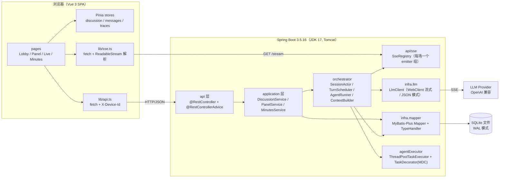
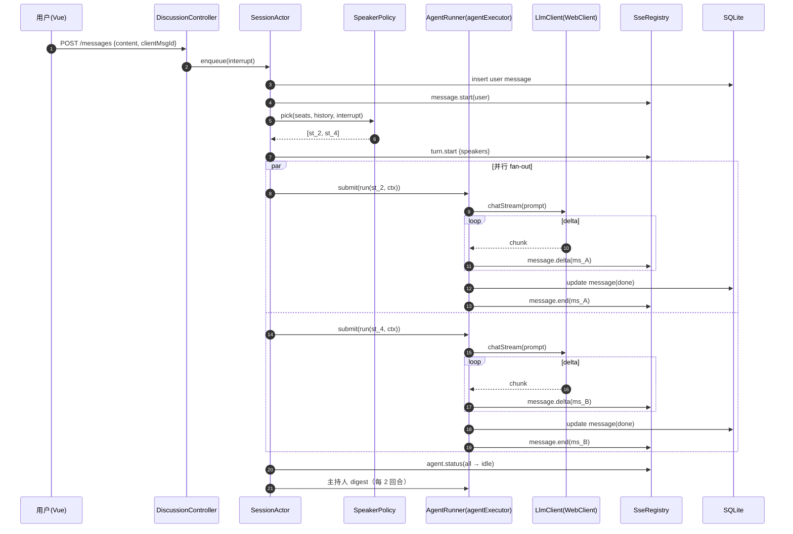
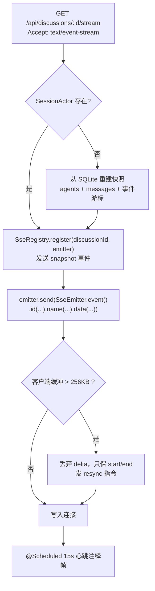
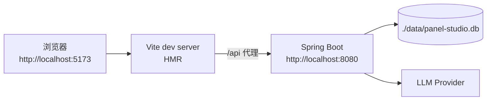
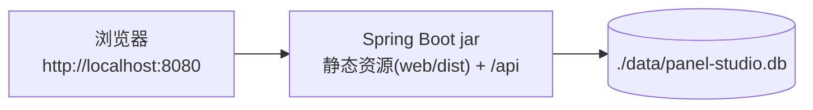

# 技术架构 · AI Panel Studio

| 项 | 内容 |
| --- | --- |
| 版本 | v1.2（技术栈：Spring Boot 3.5.16 / JDK 17 / Vue 3 / SQLite，不使用 Docker） |
| 关联 | [PRD](PRD.md) · [DATABASE](DATABASE.md) · [API](API.md) |
| 一句话 | Spring Boot 3.5.16（JDK 17）后端 + Vue 3 前端 + SQLite 单文件库；后端用一个「圆桌会话 Actor」持有全部调度状态，通过单条 SSE 连接把多 Agent 的并行流式输出多路复用到前端。 |

**技术栈（既定）**：Spring Boot **3.5.16** · JDK 17 · Spring MVC + `SseEmitter` · MyBatis-Plus 3.5.12 · Flyway 11 · SQLite 3.40+ · Maven 3.9 · Vue 3.4 + TypeScript + Vite 5 + Pinia 2 + Vue Router 4（SFC + 原生 CSS）· JUnit 5 + WireMock + Playwright · **本地原生运行（不使用 Docker）**。

---

## 1. 设计原则

1. **Agent 调度不交给框架**：多 Agent 编排是本题核心考点，`SessionActor` 自研，行为可读、可测、可解释（不用 Spring AI 的链式黑盒）。
2. **单连接多路复用**：一场圆桌只开一条 SSE，不是每个 Agent 一条连接。连接数与 agent 数解耦。
3. **失败必须局部化**：任何单个 Agent 的超时、报错、脏输出，都不能阻塞同回合其他人，也不能让整场讨论失败。
4. **状态在服务端，前端只是投影**：认领、回合、消息、轨迹全部落 SQLite；前端刷新即恢复。
5. **流式不等于不落库**：delta 只在内存里流，最终态一次性写库 —— 对 SQLite 的单写者尤其重要（避免写锁争抢）。
6. **为 JDK 17 的线程模型买单**：没有虚拟线程，就必须显式设计线程池与信号量，而不是"多开线程就行"。

---

## 2. 系统总览



分层职责（包结构 `com.panelstudio.*`）：

| 层 | 包 | 只做 | 不做 |
| --- | --- | --- | --- |
| API | `api` | `@RestController`、`@Valid` 校验、DTO 转换、异常映射、`SseEmitter` 生命周期 | 业务规则 |
| 应用 | `application` | 用例编排、`@Transactional` 事务边界、DTO 组装 | 拼 prompt |
| 编排 | `orchestrator` | 回合调度、并发控制、Agent 生命周期、SSE 广播 | 数据库细节 |
| 领域 | `domain` | 实体、状态机、发言策略（纯 Java，可单测） | IO |
| 基础设施 | `infra` | LLM 客户端、MyBatis-Plus Mapper、Flyway、配置、日志 | 业务判断 |

依赖方向：`api → application → orchestrator/domain → infra`，**禁止反向依赖**（`domain` 不 import `infra`）。

---

## 3. 关键设计

### 3.1 会话 Actor（一场圆桌一个内存状态机）

讨论进入 `LIVE` 时，`SessionActorRegistry` 为 `discussionId` 创建一个 `SessionActor`：

```java
public final class SessionActor {
    private final String discussionId;
    private volatile DiscussionStatus status;          // LIVE / SUMMARIZING / CLOSED
    private final Map<String, SeatRuntime> seats;      // ConcurrentHashMap，顺序由 orderIndex 决定
    private final TurnCounter turn;                    // 回合计数 + 阶段（IDLE/ASSIGNED/SPEAKING/DIGESTING）
    private final Map<String, Future<?>> inflight;     // seatId -> 正在跑的 agent 任务
    private final BlockingQueue<TurnTask> queue;       // 用户插话 / 下一轮触发，FIFO + 优先级
    private final Deque<SseFrame> eventBuffer;         // 最近 500 帧，用于 Last-Event-ID 续传
    private final TokenBudget budget;                  // 单场 token 上限
    private final Semaphore roomSemaphore;             // 本场最多 3 个 agent 并发
}
```

- Actor **串行消费 `queue`**（保证回合决策一致），但**回合内并行 fan-out**（`CompletableFuture` + 逐席位 `AgentRunner`）—— "顺序调度 + 并行发言"的组合。
- 单例注册表 `ConcurrentHashMap<String, SessionActor>`；进程重启后由 DB 重建（`LIVE` 场次标注 `INTERRUPTED`，前端提示"可继续或直接出纪要"）。
- 多实例扩展路径：Actor 迁到 Redis（分布式锁 + Pub/Sub），MVP 明确不做（README 边界声明）。

### 3.2 回合调度（顺序决策 + 并行生成）



**发言者选择策略**（`domain/policy/SpeakerPolicy.java`，纯函数 + 单测）：

```
score(seat) =
    3 × 被用户点名 / 文本命中其姓名
  + 2 × 用户消息命中其 focus 关键词
  + 2 × 上轮被他人引用且尚未回应
  + 1 × 距上次发言越久越优先（decay）
  - 5 × 本回合已发言
取 topK（K = 2~3，来自讨论配置）；主持人永不参与此策略，只由调度器触发。
```

关键约束：

- **同一席位不会被并发调用两次**（`inflight` 以 `seatId` 为键，`putIfAbsent` 失败即跳过）。
- **同回合互不等待**：`CompletableFuture.allOf(...).handle(...)` —— 用 `handle` 而非 `thenCombine`，单条异常不会让整组 `allOf` 提前失败。
- **两级闸门**：每场 `Semaphore(3)`、全局 `Semaphore(20)`（`MAX_CONCURRENT_AGENTS_*`），防止打爆 provider 限流。
- **超时**：首 token 45s、整条 90s。`WebClient` 的 `timeout()` + 自建 watchdog（`ScheduledExecutorService`）双保险；超时后 `Disposable.dispose()` 中断并记 `FAILED`，单条可重试（沿用 `messageId`，`attempt+1`）。

### 3.3 SSE：单连接多路复用（Spring MVC 实现）



实现要点：

- **`SseEmitter(0L)`** 永不超时；配合 `spring.mvc.async.request-timeout=-1`，避免讨论中途被容器掐断。
- **注册表**：`Map<String, CopyOnWriteArrayList<SseEmitter>>`，一场可挂多个浏览器标签页；`onCompletion/onTimeout/onError` 里反注册，防泄漏。
- **事件命名空间**：`SseEmitter.event().id(seq).name("message.delta").data(payload, MediaType.APPLICATION_JSON)`；`message.*` 带 `messageId`，前端按 id 分发 —— 这就是多路复用的落点。
- **有序性**：只保证**单条消息内** delta 有序（`seq` 递增），不保证跨 agent 全局有序（并行本无序，强行排序会牺牲首 token 延迟）。
- **写入串行化**：`ResponseBodyEmitter` 内部有写锁，多 agent 高频 `send` 会互相排队。因此 `AgentRunner` **按 60–80ms 合并 delta** 后再发送（一次 `send` 带多个 token），既降低锁竞争也降低前端重排次数。
- **代理适配**：`Cache-Control: no-cache, no-transform`、`X-Accel-Buffering: no`、关闭 `server.compression.mime-types` 中的 `text/event-stream`、nginx `proxy_buffering off`、15s 心跳。
- **断线续传**：`Last-Event-ID` = 帧序号；重连先回放 `eventBuffer` 中游标之后的帧，不足则回落为「快照 + 存量消息」。
- **写库策略**：delta 不落库；`message.end` 时一次 `UPDATE` 写最终 `content`（单条一次），失败重试 3 次后标 `persist_failed`。

### 3.4 JDK 17 线程模型（必须显式设计的部分）

| 资源 | 配置 | 理由 |
| --- | --- | --- |
| Tomcat 连接 | `server.tomcat.threads.max=200`、`accept-count=100` | SSE 长连接不占请求线程（Servlet 3 异步），但要留足普通请求 |
| `agentExecutor` | core 8 / max 16 / queue 200 / `CallerRunsPolicy` | 每个 agent 流式读占一个平台线程；`CallerRuns` 在队列满时把压力回退给调度线程，避免无声丢弃 |
| 每场并发 | `Semaphore(3)` | provider 限流下 3 路足够；也更像真实圆桌（不会 6 人同时抢话） |
| 全局并发 | `Semaphore(20)` | 20 场 × 3 路 ≈ 60 并发上限，留出 digest/minutes 的余量 |
| 心跳/超时 | 单线程 `ScheduledExecutorService` | 扫所有 emitter 发心跳、扫 inflight 查超时，一线程足够 |
| MDC 传播 | `TaskDecorator` 复制 `MDC.getCopyOfContextMap()` | 否则异步线程日志里 `discussionId` 全丢 |
| **不做什么** | 不用 `Executors.newCachedThreadPool()` | 无界线程池 + 长连接 = 内存与 FD 双爆 |

> 升级到 JDK 21 后，`agentExecutor` 可换 `Executors.newVirtualThreadPerTaskExecutor()`，并发模型代码不用改 —— 这也是把 `AgentRunner` 设计成"提交任务"而非"绑定线程"的原因。

### 3.5 上下文装配与成本控制

`ContextBuilder` 输入：席位立场、本场目标、历史消息、用户新消息、引用关系；输出：`List<ChatMessage>`。

| 部分 | 策略 |
| --- | --- |
| 系统提示 | 席位 stance/focus/voice + 发言规则（"先回应再主张，不附和，≤180 字"） |
| 议题与目标 | 全量保留（短） |
| 历史 | 最近 6 条原文 + 更早的滚动摘要（每 4 回合压缩一次，≤400 字） |
| 引用 | 被引用消息原文（最多 2 条，超长截断） |
| 用户最新输入 | 全量保留并标 `PRIORITY` |

预算：单条回复 `max_tokens=600`；单场 `budget=120k`，达 80% 时主持人提示收敛，达 100% 拒绝继续发言（仍可结束并出纪要）。

### 3.6 SQLite 的并发约束与应对（本项目的关键工程判断）

SQLite 的写操作是**全库串行**的，多 agent 同时结束消息会撞 `SQLITE_BUSY`。处理方式：

| 约束 | 应对 |
| --- | --- |
| 单写者 | 开 **WAL**：读不阻塞写、写不阻塞读；写之间串行 |
| 锁等待 | `busy_timeout=5000`（连接级），配合 HikariCP `connectionInitSql` 统一设置 |
| 连接池 | `maximumPoolSize=4`（写并发上限本就为 1，多连接只提升读并发，不宜超过 8） |
| 事务 | **短事务**：一次只写一条消息或一份纪要；禁止在事务里调 LLM（那是秒级等待，会把写锁占死） |
| 外键 | 每个连接 `PRAGMA foreign_keys=ON`（SQLite 默认关闭，容易悄悄产生孤儿数据） |
| 持久化强度 | `synchronous=NORMAL`（WAL 下足够，`FULL` 会显著拖慢流式写入） |
| 批量写 | 消息最终态单条 UPDATE；轨迹 `agent_runs` 在 `end` 时一次性 insert（不在 delta 中写） |
| 备份 | 定时 `VACUUM INTO` 快照（体积小，可下载导出）；容器挂载 `./data` 持久化 |

> 结论：SQLite 完全够这个 MVP（单机、写频率 ~10 次/分钟），但它把"事务边界"从"性能优化"变成了"正确性要求"——这是本项目最容易被忽略、也最容易在评审时被问到的地方。

### 3.7 失败隔离与降级矩阵

| 故障点 | 检测 | 处理 | 用户可见 |
| --- | --- | --- | --- |
| LLM 首 token 超时 | watchdog 45s | `dispose()` + `FAILED` | 卡片「发言中断 · 重试」 |
| LLM 429/402 | HTTP status | 指数退避 1 次后暂停调度 | 顶部横幅 + 恢复按钮 |
| 流中断（连接半闭） | `WebClient` error | 保留已收内容 + `PARTIAL` | 「内容可能不完整」 |
| JSON 校验失败（席位生成） | Jackson + 自定义校验 | 重问 1 次（附错误） | 仍失败则用预设阵容 |
| `SQLITE_BUSY` | 异常码 | 50/100/200ms 退避重试 3 次 | 静默（日志告警） |
| 磁盘写满 | IO 异常 | 暂停调度 + Actuator 告警 | 「存储异常，本场已暂停」 |
| SSE 客户端断开 | `onError/onCompletion` | 反注册，**不中断生成** | —（重连快照补齐） |
| 单实例崩溃 | 启动扫描 | `LIVE` → `INTERRUPTED` | 可「继续」或「出纪要」 |

> `SQLITE_BUSY` 的实现落点：`infra/db/SqliteBusyRetryInterceptor` 在 MyBatis `Executor.update`
> 外层统一做 50/100/200ms 三次退避重试，只包单条 mapper 写（不包 LLM/SSE），
> 命中记 `sqlite.busy` 日志并累加 `/metrics` 的 `sqliteBusy`；重试耗尽才向上抛错。

### 3.8 可观测性

- **结构化日志**：Logback + `logstash-logback-encoder` 输出 JSON；字段 `discussionId / turnId / seatId / messageId / event / latencyMs / tokens`；关键节点 `turn.start`、`agent.invoke`、`agent.first_token`、`agent.done`、`agent.fail`、`sqlite.busy`、`sse.connect`、`sse.disconnect`。
- **MDC 跨线程**：`ThreadPoolTaskExecutor.setTaskDecorator(new MdcTaskDecorator())`，`CompletableFuture` 提交前手动拷贝上下文。
- **轨迹落库**：`agent_runs` 记录每次调用（trigger、phase、耗时、token、状态）；LIVE 时走 SSE，结束后走 `GET /runs` 回放。
- **Actuator**：`/actuator/health`（db 探活 + llm 探活自定义 `HealthIndicator`）、`/actuator/metrics`、`/actuator/info`（构建版本）。
- **业务指标**：`GET /api/metrics` 聚合首 token 延迟直方图、失败率、活跃 SSE 数、SQLite busy 次数（不引 Prometheus，保持 MVP 轻量）。

---

### 3.9 数据访问层约定（MyBatis-Plus）

| 约定 | 内容 |
| --- | --- |
| 框架 | **MyBatis-Plus 3.5.12**（`mybatis-plus-spring-boot3-starter`）。不用 MyBatis 原生 `SqlSession`，也不用 JPA |
| 简单查询 | `BaseMapper` + `LambdaQueryWrapper`（类型安全，不手拼字段名） |
| 复杂聚合 | `@Select` 或 `resources/mapper/*.xml`（轨迹耗时、失败率统计） |
| 事务 | `@Transactional` 只包 DB 写；**绝不在事务里调 LLM 或 `emitter.send`**（SQLite 写锁会被锁死） |
| 并发控制 | 不使用 `SELECT … FOR UPDATE`（SQLite 无行级锁）；回合推进用 CAS：`UPDATE … WHERE turn_index = ?`，影响 0 行即冲突重试 |
| 软删除/填充 | `@TableLogic` + `MetaObjectHandler`；JSON 用 `JacksonTypeHandler` |

完整字段映射、拦截器配置与"硬规矩"见 [DATABASE.md](DATABASE.md) §6。

---

### 3.10 多讨论隔离与密钥边界

作业要求：**多个讨论可并行，不同讨论的状态、事件流、transcript、共识与分歧必须互相隔离**；**大模型 API Key 只能放在后端**。

**隔离矩阵**

| 维度 | 载体 | 隔离方式 | 串台后果 |
| --- | --- | --- | --- |
| 调度状态 | `SessionActorRegistry` | key = `discussionId`；每场独立 `queue / inflight / turn / budget` | 推进了别人的回合 |
| 事件流 | `SseRegistry` | key = `discussionId`，value 为本场 emitter 列表；广播只遍历本场 | 看到别场的发言 |
| Transcript | `messages` 表 | Repository 只暴露"按场次"方法（`findByDiscussionId`），不向业务层开放全表查询 | 纪要混入其他场次消息 |
| 共识/分歧 | `minutes` | 生成时只读本场 messages；落库前校验 `seatId` 属于本场 | 纪要张冠李戴 |
| 并发资源 | 每场 `Semaphore(3)` + 全局 `Semaphore(20)` | 单场跑满不饿死其他场 | 一场长讨论拖垮全站 |
| 预算 | `TokenBudget`（每 actor 一个） | 单场 120k，互不借额 | 一场烧完全局额度 |
| 前端 | Pinia store 按 `discussionId` 建 key；页面只订阅一条 stream | 切场先 `abort()` 旧连接并清空 store | 上一场消息残留在新界面 |

**禁止写法**（code review 直接打回）：

1. `static` 可变集合存会话数据（多实例/热部署必炸）；
2. 单例 Service 里缓存"当前讨论"；
3. 全局 emitter 集合不按 `discussionId` 分组；
4. 业务层直接 `selectList(null)` 取全表再在内存过滤。

**密钥边界**

| 项 | 做法 |
| --- | --- |
| 读取 | `LLM_API_KEY` 只从环境变量读（`@ConfigurationProperties`），`application.yml` 里不写明文，`.env` 进 `.gitignore` |
| 前端 | 前端只调本项目 `/api/**`，不直连模型厂商；**不要**把 key 放进 `VITE_*` 变量（Vite 会把它编进产物，等于公开） |
| 日志 | 打印上游请求时剔除 `Authorization`；异常不回传上游原始 body |
| CORS | 只允许 `WEB_ORIGIN`，不用 `*` |
| 构建期校验 | `scripts/build` 结束后扫描 `web/dist` 是否出现 `sk-` / `apiKey`，命中即构建失败 |

---

## 4. 技术选型与取舍

| 决策 | 选择 | 放弃的方案 | 理由 |
| --- | --- | --- | --- |
| 后端框架 | Spring Boot 3.5.16 + JDK 17 | Quarkus / 纯 Servlet | 项目既定；3.5 是 3.x 的最新线，生态与文档对评审友好；JDK 17 LTS 稳定 |
| Web 层 | Spring MVC | Spring WebFlux | 数据访问是阻塞式的（MyBatis-Plus + SQLite），混用 R2DBC 得不偿失；80 路 SSE 用线程池足够，WebFlux 的复杂度换不来收益 |
| SSE 实现 | `SseEmitter` | WebSocket / `ResponseBodyEmitter` | 只需单向推送；`SseEmitter` 自带事件名/ID/重连语义，比裸写 `PrintWriter` 省事 |
| 编排 | 自研 `SessionActor` | Spring AI / LangChain4j | 调度是评分核心，框架把重试、内存、流式封装成黑盒，出问题无法解释；自研约 500 行，策略是纯函数可单测 |
| LLM 调用 | `WebClient` 手写流式解析 + JSON 模式 | Spring AI `ChatClient` | 需要精确控制 abort / 首 token 超时 / 单席位模型差异；适配层接口保留，后续可替换 |
| ORM | MyBatis-Plus | Spring Data JPA (Hibernate) | Hibernate 的 SQLite 方言属社区维护，JSON/部分索引支持别扭；MyBatis-Plus 的 `JacksonTypeHandler` 处理 JSON 字段更直接，SQL 可控 |
| 数据库 | **SQLite 3（WAL）** | PostgreSQL / MySQL | 项目既定。零运维、单文件、随包分发，评审一条命令就能跑；代价是单写者与无水平扩展 —— 用短事务 + 单条 UPDATE + 重试兜住，并在 DATABASE.md 写明迁移到 PG 的路径 |
| 前端 | Vue 3.4 + **原生 CSS** | — | 项目既定；圆桌场景的三色席位、消息流、轨迹时间线均为场景定制组件，样式集中在设计令牌便于统一调整 |
| 状态管理 | Pinia 2 | Vuex / 自建 eventBus | Vue 3 官方推荐，模块化清晰；流式消息用 `Map<messageId, Bubble>` 存，配合 rAF 合批 |
| 前端 SSE | `fetch` + `ReadableStream` | 原生 `EventSource` | `EventSource` **不能设置请求头**（本项目要带 `X-Device-Id`），也不能主动 abort；自解析约 80 行，换来完整控制 |
| 测试 | JUnit 5 + MockMvc + WireMock + Playwright | Postman / 纯手工 | 后端用例离线可跑（WireMock 造故障），E2E 覆盖真实浏览器 |

**为什么不用 WebFlux**：本项目 90% 的时间花在等 LLM，看似"适合响应式"，但 SQLite + MyBatis-Plus 是阻塞式，混用要么全链路 R2DBC（SQLite 无官方响应式驱动），要么在 `boundedElastic` 上跑阻塞代码（等于线程池，还多了心智负担）。MVC + 显式线程池在这个规模是更诚实的选择。

**为什么 SQLite 也敢用于"并发流式"场景**：并发发生在**网络 IO**（多路 LLM 流），不在数据库。落库是"每条消息结束时一次 UPDATE"，单场 4 agent × 8 回合 ≈ 32 次写，完全在 SQLite 能力范围内。真正的坑是"在事务里等 LLM"——禁止即可。

---

## 5. 目录结构（目标态）

```text
ai-panel-studio/
├── server/
│   ├── pom.xml                        # spring-boot-starter-web/validation/actuator,
│   │                                  # mybatis-plus-boot-starter, flyway-core, sqlite-jdbc,
│   │                                  # springdoc-openapi, logstash-logback-encoder, wiremock(test)
│   └── src/
│       ├── main/java/com/panelstudio/
│       │   ├── PanelStudioApplication.java
│       │   ├── api/
│       │   │   ├── DiscussionController.java
│       │   │   ├── PanelController.java
│       │   │   ├── MessageController.java
│       │   │   ├── MinutesController.java
│       │   │   ├── StreamController.java        # SseEmitter
│       │   │   ├── dto/                          # 请求/响应 record
│       │   │   ├── sse/SseRegistry.java          # 注册表 + 广播 + 续传
│       │   │   └── advice/ApiExceptionHandler.java
│       │   ├── application/                      # DiscussionService / PanelService / MinutesService
│       │   ├── orchestrator/                     # SessionActor / ActorRegistry / TurnScheduler
│       │   │                                     # AgentRunner / ContextBuilder / TokenBudget
│       │   ├── domain/
│       │   │   ├── entity/                       # Discussion / Seat / Message / Minute / AgentRun
│       │   │   ├── policy/SpeakerPolicy.java
│       │   │   ├── statemachine/DiscussionStateMachine.java
│       │   │   └── enums/
│       │   └── infra/
│       │       ├── llm/LlmClient.java  llm/OpenAiCompatibleClient.java  llm/PromptTemplates.java
│       │       ├── mapper/                       # MyBatis-Plus Mapper 接口
│       │       ├── config/                       # MybatisPlusConfig / AsyncConfig(MDC) / WebConfig
│       │       └── logging/
│       ├── main/resources/
│       │   ├── application.yml
│       │   ├── db/migration/V1__schema.sql V2__indexes.sql V3__seed_demo.sql
│       │   └── mapper/*.xml
│       └── test/java/...                          # 单测 + MockMvc 集成 + WireMock
├── web/
│   ├── src/pages/{Lobby,Panel,Live,Minutes}.vue
│   ├── src/components/{SeatCard,MessageBubble,TracePanel,Composer,Dialogs}*.vue
│   ├── src/stores/{discussion,messages,traces}.ts
│   ├── src/lib/{api,sse,format,copy}.ts          # copy.ts = 中文文案常量
│   └── src/styles/{tokens,layout,pages}.css
├── e2e/                                           # playwright.config.ts + specs
├── scripts/                                       # dev.sh/dev.bat/build.sh/build.bat（无容器，纯本机脚本）
├── docs/
├── data/                                          # panel-studio.db（gitignore）
└── README.md
```

---

## 6. 运行方式（本地原生，不使用容器）

> 本项目**不使用 Docker / 容器 / nginx**：数据库是 SQLite 文件，本身就没有"要编排的服务"，加一层容器只会让评审多一步、让流式代理多一个坑。全部通过本机命令与脚本启动。

### 6.1 开发模式（前后端分离，热更新）



- 前端 Vite `server.proxy['/api'] → http://127.0.0.1:8080`，开发期不存在跨域，也不需要反向代理软件。
- 后端 `mvn -f server/pom.xml spring-boot:run`；启动时 Flyway 自动迁移，SQLite 文件不存在则创建。

### 6.2 演示模式（单进程，一条命令）



`scripts/build.sh`（或 `build.bat`）做三件事：

1. `pnpm -C web build` → 产出 `web/dist`；
2. 把 `web/dist` 复制到 `server/src/main/resources/static/`（Vue Router 用 hash 模式或配置 `forward:/index.html` 兜底，避免刷新 404）；
3. `mvn -f server/pom.xml clean package` → `server/target/panel-studio.jar`。

之后 `java -jar server/target/panel-studio.jar` 单进程跑完整应用 —— 演示视频与交付验收只需要这一个命令。

### 6.3 环境变量与数据

- 配置读取顺序：`application.yml` → 操作系统环境变量 → `.env`（通过 `scripts/dev.sh` 导出）。关键项：`SERVER_PORT`、`SQLITE_PATH`、`LLM_BASE_URL`、`LLM_API_KEY`、`LLM_MODEL`、`MAX_CONCURRENT_AGENTS_PER_ROOM`、`MAX_CONCURRENT_AGENTS_GLOBAL`、`TURN_SPEAKER_LIMIT`、`DISCUSSION_TOKEN_BUDGET`。
- 数据目录 `./data/`（gitignore），可用 `SQLITE_PATH` 指向别处。
- 备份：`sqlite3 data/panel-studio.db "VACUUM INTO 'data/backup-2026-11-17.db'"`（或直接复制 `.db` + `-wal` 文件，需先停服）。
- 首次启动写入演示数据（Flyway `V3__seed_demo.sql`），保证一进来列表不是空的。

---

## 7. 演进路径（写进 README 的"边界声明"）

| 现在（MVP） | 下一步 |
| --- | --- |
| 进程内 Actor | Redis 分布式锁 + Pub/Sub，支持多实例 |
| SQLite 单文件 | 迁 PostgreSQL：Flyway 双套脚本 + MyBatis-Plus 多方言（SQL 已刻意保持可移植：不用 SQLite 专有语法，JSON 用 TEXT 存） |
| 匿名 `X-Device-Id` | Spring Security + 账号体系，圆桌支持多人围观 |
| 单 LLM | 席位绑定不同模型（战略顾问用推理模型，技术专家用代码模型） |
| 内存 `eventBuffer` | 事件表 + 游标（`agent_runs` 已预留，补 `events` 表即可） |
