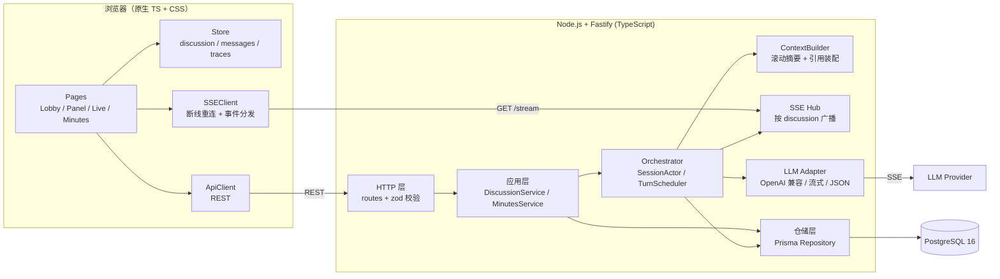
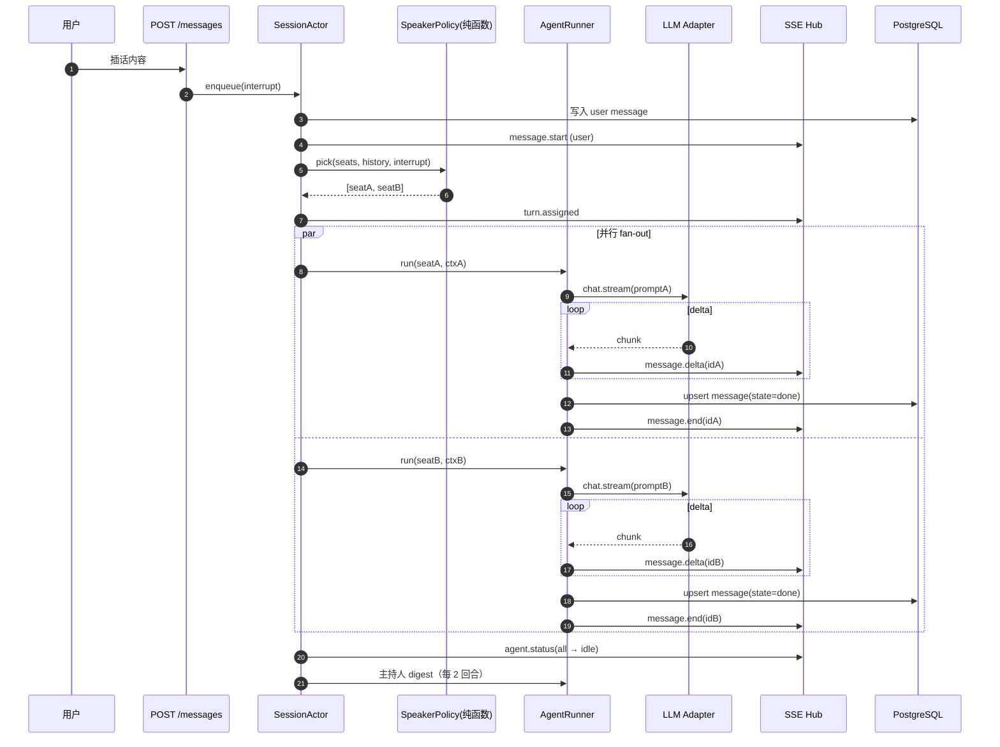
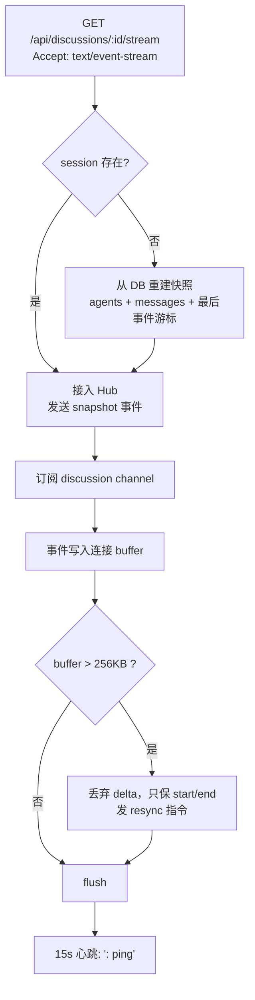
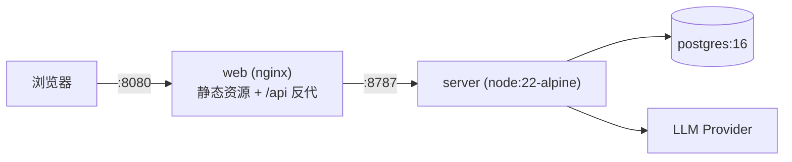

# 技术架构 · AI Panel Studio

| 项 | 内容 |
| --- | --- |
| 版本 | v1.0 |
| 关联 | [PRD](PRD.md) · [DATABASE](DATABASE.md) · [API](API.md) |
| 一句话 | 前后端分离；后端用一个「圆桌会话 actor」持有全部调度状态，通过单条 SSE 连接把多 Agent 的并行流式输出多路复用到前端。 |

---

## 1. 设计原则

1. **Agent 调度不交给框架**：多 Agent 编排是本，Orchestrator 自研，行为可读、可测、可解释。
2. **单连接多路复用**：一场圆桌只开一条 SSE，不是每个 Agent 一条连接。连接数与 agent 数解耦。
3. **失败必须局部化**：任何单个 Agent 的超时、报错、脏输出，都不能阻塞同回合其他人，也不能让整场讨论失败。
4. **状态在服务端，前端只是投影**：认领、回合、消息、轨迹全部落库；前端刷新即恢复。
5. **流式不等于不落库**：delta 只在内存里流，最终态一次性写库，避免写风暴。

---

## 2. 系统总览



分层职责：

| 层 | 目录 | 只做 | 不做 |
| --- | --- | --- | --- |
| HTTP | `apps/server/src/http` | 参数校验、鉴权、错误映射、协议转换 | 业务规则 |
| 应用 | `src/application` | 用例编排、事务边界、DTO | 直接拼 prompt |
| 编排 | `src/orchestrator` | 回合调度、并发控制、Agent 生命周期 | 数据库细节 |
| 领域 | `src/domain` | 实体、状态机、发言策略（纯函数，可单测） | IO |
| 基础设施 | `src/infra` | LLM、Prisma、SSE Hub、日志、配置 | 业务判断 |

---

## 3. 关键设计

### 3.1 会话 Actor（一场圆桌一个内存状态机）

讨论进入 `LIVE` 时，服务端为 `discussionId` 创建一个 `SessionActor`，持有：

```ts
type SessionState = {
  discussionId: string;
  status: 'LIVE' | 'SUMMARIZING' | 'CLOSED';
  seats: Map<seatId, SeatRuntime>;      // 席位运行时（含认领信息）
  turn: { index: number; phase: 'IDLE'|'ASSIGNED'|'SPEAKING'|'DIGESTING' };
  inflight: Map<messageId, AbortController>;
  queue: TurnTask[];                    // 用户插话 / 下一轮触发
  eventBuffer: RingBuffer<SseEvent>;    // 最近 500 条事件，用于 Last-Event-ID 续传
  budget: { tokensUsed: number; limit: number };
};
```

- Actor 串行消费 `queue`，但**回合内并行 fan-out**（`Promise.allSettled`），这是"顺序调度 + 并行发言"的组合。
- Actor 是进程内单例（`Map<discussionId, Actor>`），重启后由 DB 重建（`LIVE` 状态的场次标记为 `INTERRUPTED`，前端提示"讨论已中断，可继续或结束"）。
- 单机多实例扩展路径：Actor 迁到 Redis + 分布式锁；MVP 明确不做（在 README 中说明边界）。

### 3.2 回合调度（顺序决策 + 并行生成）



**发言者选择策略**（`domain/policy/speaker.ts`，纯函数 + 单测）：

```
score(seat) =
    3 * 被用户点名
  + 2 * 用户消息含其 focus 关键词
  + 2 * 上轮被他人引用且未回应
  + 1 * 距上次发言越久越优先（decay）
  - 5 * 本回合已发言
取 topK（K = 2~3，来自讨论配置）；主持人永不被策略选中，只由调度器触发。
```

关键点：

- **同一 Agent 不会被并发调用两次**（`inflight` 键为 `seatId`），避免自相矛盾。
- **同回合内互不等待**：`Promise.allSettled`，单条失败不影响其他。
- **总并发闸门**：每场 `semaphore(3)`，全局 `semaphore(20)`，防止打爆 provider 限流。
- **超时**：首 token 45s、整条 90s，`AbortController` 主动中断并记 `failed`，可单条重试（重试沿用同一 `messageId` 的 `attempt+1`）。

### 3.3 SSE：单连接多路复用



- **事件命名空间**：所有 `message.*` 事件带 `messageId`，前端按 id 分发到对应卡片 —— 这就是"多路复用"的落点。
- **有序性**：只保证**单条消息内** delta 有序（`seq` 递增），不保证跨 agent 全局有序（并行本无序，强行排序会牺牲首 token 延迟）。
- **断线续传**：`Last-Event-ID` = 事件游标；重连时先回放 `eventBuffer` 中游标之后的事件，不足则回落为「快照 + 存量消息」。
- **代理适配**：`Content-Type: text/event-stream`、`Cache-Control: no-cache, no-transform`、`X-Accel-Buffering: no`、禁用 gzip、15s 心跳注释帧。
- **写库策略**：delta 不落库；`message.end` 时写最终 `content`（单条一次 UPDATE），失败重试 3 次后标记 `persist_failed`。

### 3.4 上下文装配与成本控制

`ContextBuilder` 输入：席位立场、本场目标、历史消息、用户新消息、引用关系。输出：messages 数组。

| 部分 | 策略 |
| --- | --- |
| 系统提示 | 席位 stance/focus/voice + 发言规则（"先回应再主张，不附和，≤180 字"） |
| 议题与目标 | 全量保留（短） |
| 历史 | 最近 6 条原文 + 更早的滚动摘要（每 4 回合压缩一次，≤400 字） |
| 引用 | 被引用消息原文（最多 2 条，超长截断） |
| 用户最新输入 | 全量保留并标 `PRIORITY` |

预算：单条回复 `max_tokens=600`；单场 `budget.limit = 120k tokens`，达 80% 时主持人提示"本场讨论接近预算，建议收敛"，达 100% 拒绝继续发言（可手动结束生成纪要）。

### 3.5 失败隔离与降级矩阵

| 故障点 | 检测 | 处理 | 用户可见 |
| --- | --- | --- | --- |
| LLM 首 token 超时 | 45s timer | abort + `failed` | 卡片「发言中断 · 重试」 |
| LLM 429/402 | HTTP status | 指数退避 1 次后暂停调度 | 顶部横幅 + 恢复按钮 |
| 流中断（连接半闭） | `stream` error | 保留已收内容 + `partial` | 「内容可能不完整」 |
| JSON 校验失败（席位生成） | zod | 重问 1 次（附错误） | 仍失败则用预设阵容 |
| DB 写失败 | Prisma error | 内存队列重试 3 次 | 「本条可能未保存」 |
| SSE 客户端断开 | close event | 注销订阅，**不中断生成** | —（重连后快照补齐） |
| 单实例崩溃 | 启动扫描 | `LIVE` → `INTERRUPTED` | 可「继续讨论」或「直接出纪要」 |

### 3.6 可观测性

- **结构化日志**：`{ ts, level, discussionId, turnId, seatId, messageId, event, latencyMs, tokens }`，关键节点：`turn.start / agent.invoke / agent.first_token / agent.done / agent.fail / persist / sse.connect / sse.disconnect`。
- **轨迹落库**：`agent_runs` 表记录每次调用的 input_digest、phase、耗时、token、状态；前端轨迹面板即读此表（LIVE 时走 SSE，结束后走 REST 回放）。
- **健康检查**：`GET /api/health` 返回 `{ db, llm, uptime }`。
- **轻量指标**：进程内计数器（首 token 延迟直方图、失败率、活跃 SSE 数），`GET /api/metrics` 输出 JSON（不引 Prometheus，保持 MVP 轻量）。

---

## 4. 技术选型与取舍

| 决策 | 选择 | 放弃的方案 | 理由 |
| --- | --- | --- | --- |
| 实时通道 | SSE | WebSocket | 单向推送足够；SSE 走 HTTP，免握手/心跳协议、易调试；断线续传只需 `Last-Event-ID` |
| 后端框架 | Fastify | Express | 原生流式 reply、schema 校验快、性能更好；类型体验好 |
| ORM | Prisma | 裸 SQL / Drizzle | 迁移与类型生成成熟；JSONB 字段支持好；ER 与 schema 可一一对应 |
| 数据库 | PostgreSQL 16 | SQLite | 需要 JSONB、并发写、`ON CONFLICT` 幂等；贴近生产 |
| 前端 | 原生 TS + 手写 CSS | React / Vue / 组件库 | 硬性约束禁止 UI 框架；手写 CSS 反而更易做到"三色区分 + 三栏布局"的精确控制 |
| 状态管理 | 极简 pub/sub store（~100 行） | Redux / Zustand | 状态结构简单（messages map + traces ring），自写够用且零依赖 |
| 测试 | Vitest + Playwright | Jest + Cypress | 与 Vite/TS 原生契合，E2E 稳定 |
| LLM | OpenAI 兼容接口 + 适配层 | 绑定单一 SDK | 可切换供应商；适配层统一处理流式与 JSON 模式；便于 Mock 录制回放 |

**为什么不用 Agent 编排框架**：LangChain 等会把调度藏在链式黑盒里，而本题评分重点正是"多 Agent 并发调度的正确性"。自研 Actor + Policy 只有约 400 行，行为完全可控，也便于写单测（策略是纯函数）。

---

## 5. 目录结构（目标态）

```text
ai-panel-studio/
├── apps/
│   ├── web/
│   │   ├── index.html
│   │   ├── src/
│   │   │   ├── pages/          # lobby / panel / live / minutes
│   │   │   ├── components/     # seat-card, message-bubble, trace-panel, composer
│   │   │   ├── lib/            # api.ts, sse.ts, store.ts, dom.ts
│   │   │   └── styles/         # tokens.css, layout.css, pages/*.css
│   │   └── vite.config.ts
│   └── server/
│       ├── src/
│       │   ├── http/           # routes/*.ts, plugins/error.ts, plugins/validate.ts
│       │   ├── application/    # discussion.service.ts, minutes.service.ts, panel.service.ts
│       │   ├── orchestrator/   # session-actor.ts, turn-scheduler.ts, agent-runner.ts, context-builder.ts
│       │   ├── domain/         # entities/, policy/speaker.ts, state-machine.ts
│       │   ├── infra/          # llm/adapter.ts, db/repos/*.ts, sse/hub.ts, logger.ts, config.ts
│       │   └── server.ts
│       └── test/               # 单测 + 集成（含 LLM mock）
├── packages/shared/            # 类型、SSE 事件联合类型、zod schema
├── db/
│   ├── schema.prisma
│   ├── migrations/
│   └── seed.ts
├── e2e/                        # Playwright specs + fixtures
├── docs/
├── docker-compose.yml
└── README.md
```

---

## 6. 部署



- `docker-compose.yml`：`web`（nginx 托管静态资源并反代 `/api`，关闭 `proxy_buffering`）、`server`（多阶段构建，非 root 运行）、`db`（volume 持久化 + `healthcheck`）。
- 启动顺序：`db healthy → server（跑 migration）→ web`。
- 环境变量：`LLM_BASE_URL`、`LLM_API_KEY`、`LLM_MODEL`、`DATABASE_URL`、`PORT`、`MAX_CONCURRENT_AGENTS`、`TURN_SPEAKER_LIMIT`、`DISCUSSION_TOKEN_BUDGET`，见 `.env.example`。

---

## 7. 演进路径（写进 README 的"边界声明"）

| 现在 | 下一步 |
| --- | --- |
| 进程内 Actor | Redis Streams + 分布式锁，支持多实例 |
| 匿名 deviceId | 接入账号体系，圆桌支持多人围观 |
| 单 LLM | 席位绑定不同模型（战略顾问用推理模型，技术专家用代码模型） |
| 内存 eventBuffer | 事件表 + 游标（已预留 `agent_runs`，补 `events` 表即可） |
