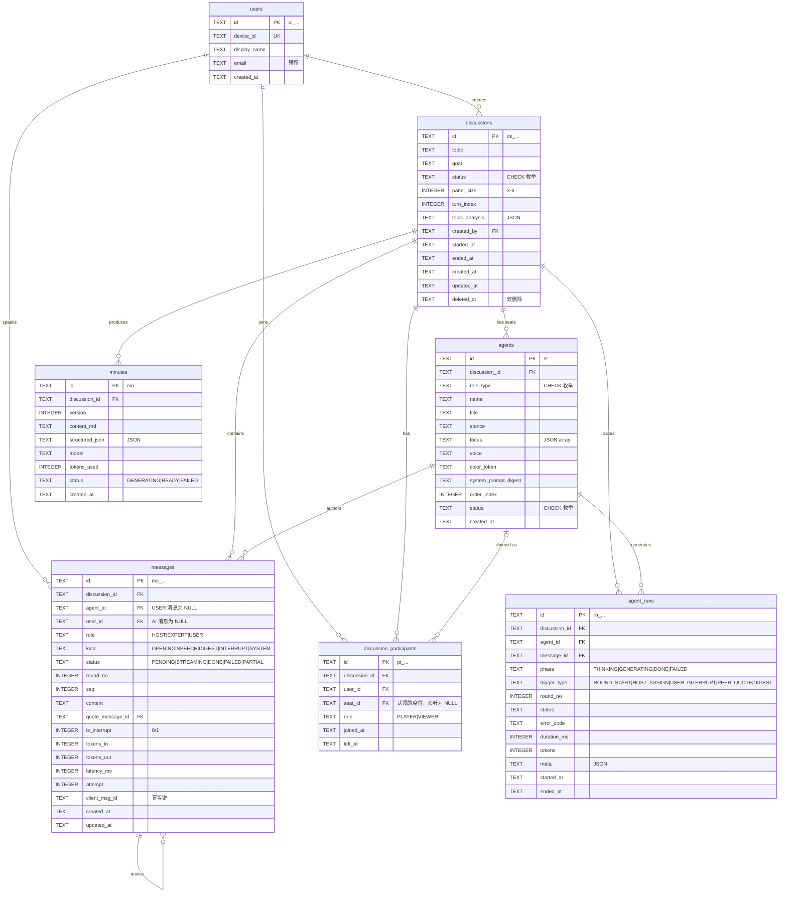
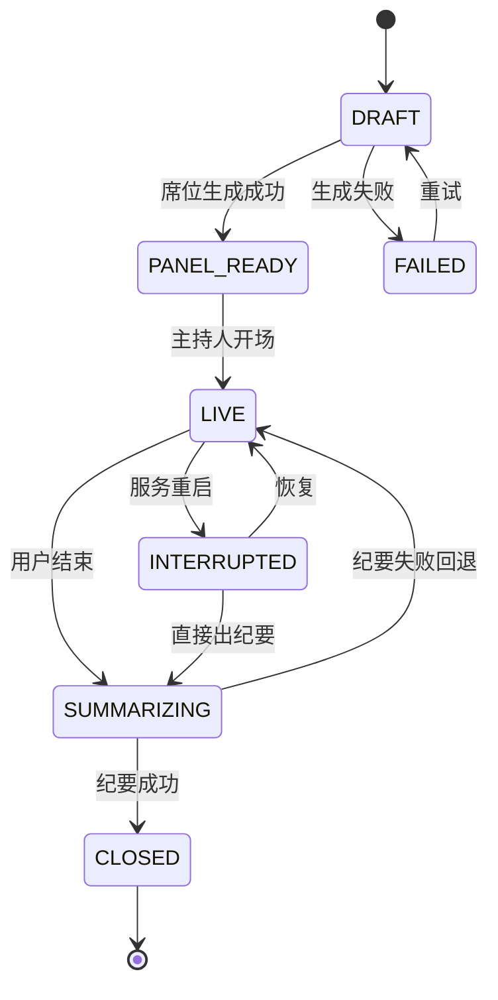

# 数据库设计 · AI Panel Studio

| 项 | 内容 |
| --- | --- |
| 版本 | v1.2（数据库 SQLite；Spring Boot 3.5.16 / Flyway 11） |
| 数据库 | **SQLite 3.40+**（WAL 模式，单文件） |
| ORM | MyBatis-Plus 3.5.12（`JacksonTypeHandler` 映射 JSON 字段） |
| 连接池 | HikariCP（`maximumPoolSize=4`，写并发实际为 1） |
| 迁移 | Flyway 11（`V1__schema.sql` / `V2__indexes.sql` / `V3__seed_demo.sql`） |
| 表数量 | 7（满足 ≥5 张表的硬性要求） |
| 命名约定 | 表名复数 snake_case；主键 `id TEXT`（前缀 + ULID）；时间 `TEXT`（ISO-8601 UTC，如 `2026-11-17T08:12:31.482Z`） |

---

## 1. 为什么用 SQLite，以及它带来的硬约束

### 1.1 理由

| 维度 | 说明 |
| --- | --- |
| 形态匹配 | 本项目是单机 MVP：一个 Spring Boot 进程 + 一个前端。没有独立 DB 服务，用 SQLite 就少一层运维与联调成本，评审 `java -jar` 即可跑 |
| 事务完整性 | SQLite 支持完整 ACID 与外键（需显式开启），纪要/消息的一致性要求它能满足 |
| 迁移成本 | 单文件可备份、可随包分发；演示时"把 db 文件带走"就能复现同一场讨论 |
| 写负载 | 单场 4 agent × 8 回合 ≈ 32 次写；单机 20 场并发 ≈ 10 次写/秒，远低于 SQLite 上限 |

### 1.2 硬约束（写进代码规范，评审要能被问到）

| 约束 | 具体要求 | 不这么做的后果 |
| --- | --- | --- |
| **单写者** | 所有写操作串行；开 WAL 让读写互不阻塞 | 多写并发直接 `SQLITE_BUSY`，表现为"消息偶尔丢" |
| **事务必须短** | 一个事务只写一条消息 / 一份纪要；**严禁在事务内调 LLM** | LLM 是秒级等待，会把写锁占死，全场卡住 |
| **busy_timeout** | 5000ms（连接初始化统一设置），叠加 50/100/200ms 应用层退避重试 3 次 | 瞬时争抢直接抛错给用户 |
| **外键默认关闭** | 每个连接 `PRAGMA foreign_keys=ON` | 静默产生孤儿消息 / 幽灵席位 |
| **连接池不能大** | `maximumPoolSize=4`（多连接只提升读并发，写仍串行） | 连接多、写锁争抢反而更严重 |
| **持久化强度** | `synchronous=NORMAL`（WAL 下安全且快） | `FULL` 每次 commit 刷盘，流式落库明显变慢 |
| **JSON 存 TEXT** | `topic_analysis` / `structured_json` 存 JSON 字符串，用 `json_extract` 查询 | 用 SQLite 的 `jsonb`（实验特性）会绑死版本 |
| **不用专有语法** | DDL/DML 保持在 PG 也能跑的子集 | 后续迁移要重写全部 SQL |

### 1.3 连接配置（`application.yml`）

```yaml
spring:
  datasource:
    url: jdbc:sqlite:${SQLITE_PATH:./data/panel-studio.db}?journal_mode=WAL&synchronous=NORMAL&busy_timeout=5000&foreign_keys=on
    hikari:
      maximum-pool-size: 4
      minimum-idle: 1
      connection-timeout: 3000
      connection-init-sql: PRAGMA foreign_keys=ON;
  flyway:
    enabled: true
    locations: classpath:db/migration
    baseline-on-migrate: true
```

> 说明：`journal_mode` 等参数由 xerial `sqlite-jdbc` 从 URL 解析并写入 `SQLiteConfig`；`connection-init-sql` 是双保险（连接池复用时确保外键开启）。
> Flyway 11 的 SQLite 方言**仍在 `flyway-core` 内**（jar 内含 `org/flywaydb/core/internal/database/sqlite/`），Maven Central 上并不存在 `org.flywaydb:flyway-database-sqlite` 这个 artifact，因此 `pom.xml` 只依赖 `flyway-core`（版本由 Spring Boot 3.5.16 的 dependencyManagement 托管）。

---

## 2. ER 图



> SQLite 没有原生 enum / array / jsonb：枚举用 `TEXT + CHECK`，数组与对象用 `TEXT` 存 JSON（MyBatis-Plus `JacksonTypeHandler` 自动序列化），时间统一 `TEXT` ISO-8601 UTC（字典序 = 时间序，可直接 `ORDER BY`）。

---

## 3. 表设计说明

### 3.1 `users` — 用户（匿名优先，账号预留）

| 字段 | 类型 | 约束 | 说明 |
| --- | --- | --- | --- |
| `id` | TEXT | PK | `ul_` + ULID |
| `device_id` | TEXT | UNIQUE NOT NULL | 前端 localStorage 生成，随 `X-Device-Id` 上送 |
| `display_name` | TEXT | NOT NULL DEFAULT '旁听者' | 认领席位时可改昵称 |
| `email` | TEXT | NULL | 预留账号体系 |

> MVP 无登录。设备 ID 让"我参与的圆桌"跨会话可识别；后续接账号时按 `device_id` 合并。

### 3.2 `discussions` — 圆桌

| 字段 | 类型 | 约束 | 说明 |
| --- | --- | --- | --- |
| `topic` | TEXT | NOT NULL, `CHECK(length(topic) BETWEEN 8 AND 200)` | 用户输入的议题 |
| `goal` | TEXT | NULL | 议题分析产出的"本场要回答的问题" |
| `status` | TEXT | NOT NULL DEFAULT `DRAFT`, CHECK 枚举 | 见 §4.1 状态机 |
| `panel_size` | INTEGER | NOT NULL DEFAULT 4, `CHECK 3..6` | 1 主持 + (size-1) 专家 |
| `turn_index` | INTEGER | NOT NULL DEFAULT 0 | 已完成回合数 |
| `topic_analysis` | TEXT | NULL（JSON） | `{"disputes":[],"audience":[],"angles":[]}` |
| `created_by` | TEXT | FK users, `ON DELETE SET NULL` | |
| `deleted_at` | TEXT | NULL | 软删除；MyBatis-Plus `@TableLogic` |

### 3.3 `agents` — 席位（含主持人）

| 字段 | 说明 |
| --- | --- |
| `role_type` | CHECK 枚举；`HOST` 每场唯一且 `order_index=0` |
| `stance` | 一句话立场，是"分歧"的载体，必填 |
| `focus` | JSON 数组（2–4 个关键词），用于策略打分与上下文聚焦 |
| `voice` | 说话风格，注入 prompt |
| `system_prompt_digest` | **只存摘要**（sha256 前 16 位 + 200 字概述），不向前端暴露原始 prompt |
| `status` | `ACTIVE` / `REPLACED_BY_USER`（用户认领）/ `RETIRED`（换一批被替换） |

### 3.4 `messages` — 消息（讨论的唯一事实流）

| 字段 | 说明 |
| --- | --- |
| `role` | `HOST` / `EXPERT` / `USER`，前端据此决定气泡样式 |
| `kind` | `OPENING` 开场、`SPEECH` 发言、`DIGEST` 主持人收束、`INTERRUPT` 用户插话、`SYSTEM` 系统提示 |
| `status` | `DONE` 正常；`FAILED` 可重试；`PARTIAL` 流中断但保留内容 |
| `round_no` | 所属回合（从 1 开始）；`OPENING` 为 0 |
| `seq` | 该消息收到的 delta 序号上限（前端去重/排序） |
| `quote_message_id` | 引用/反驳目标，自关联 `ON DELETE SET NULL` |
| `is_interrupt` | 0/1，调度器据此提升优先级 |
| `client_msg_id` | 幂等键，`UNIQUE(discussion_id, client_msg_id)` |
| `attempt` | 重试次数；重试沿用同一 `id`，`attempt+1` |

**delta 不落库**：单场约 1 万条 delta 若逐条写，SQLite 会被写锁打爆。只在 `message.end` 一次 `UPDATE` 写最终 `content` + `tokens_out` + `latency_ms` —— 写入量降到 1/300，也避免长事务。

### 3.5 `minutes` — 会议纪要（版本化）

| 字段 | 说明 |
| --- | --- |
| `version` | 同一 discussion 内自增，`UNIQUE(discussion_id, version)` |
| `content_md` | 可直接复制/导出的 Markdown |
| `structured_json` | 六段式 JSON（TEXT），每条要点带 `sourceMessageIds`，供溯源跳转 |
| `status` | `GENERATING` 时前端先渲染骨架；失败保留上一版 |

`structured_json` 形状：

```json
{
  "topic": "…",
  "goal": "…",
  "claims": [{ "seatId": "st_2", "name": "陈立", "points": ["…"], "sourceMessageIds": ["ms_07"] }],
  "disputes": [{ "question": "…", "sideA": { "seats": ["st_2"], "argument": "…", "sources": ["ms_07"] },
                 "sideB": { "seats": ["st_4"], "argument": "…", "sources": ["ms_09"] },
                 "unresolvedBecause": "缺少冷启动数据" }],
  "consensus": ["…"],
  "hypotheses": ["若 7 日内 CTR 提升 < 3%，则方案不成立"],
  "nextSteps": [{ "action": "…", "proposedBy": "周敏" }]
}
```

### 3.6 `agent_runs` — Agent 运行轨迹（可观测 + 轨迹面板数据源）

每次 LLM 调用一行。`phase` 从 `THINKING` → `GENERATING` → `DONE`/`FAILED`；`trigger_type` 记录"为什么说这句"，即 PRD FR-5 里"展开可见触发动机"的落地方式。

- 用途：轨迹回放、失败率统计、首 token 延迟分析、按席位归因 token 成本。
- 不存 prompt 原文，只存 `meta`（引用 id、上下文摘要、模型与参数），避免泄漏与体积膨胀。

### 3.7 `discussion_participants` — 参与关系（认领/旁听）

- `PLAYER` 必须带 `seat_id`；`VIEWER` 为 `NULL`。
- `UNIQUE(discussion_id, user_id)`（单用户单场一条）+ 部分唯一索引保证一个席位只被一人认领（§5）。

---

## 4. 枚举与状态机

### 4.1 `discussions.status`



### 4.2 全部枚举（`CHECK` 约束的取值）

| 枚举 | 取值 |
| --- | --- |
| `discussions.status` | `DRAFT` `PANEL_READY` `LIVE` `SUMMARIZING` `CLOSED` `INTERRUPTED` `FAILED` |
| `agents.role_type` | `HOST` `STRATEGIST` `ANALYST` `TECH` `FINANCE` `RESEARCHER` |
| `agents.status` | `ACTIVE` `REPLACED_BY_USER` `RETIRED` |
| `agents.color_token` | `slate`(主持) `amber` `teal` `indigo` `violet` `rose` `emerald`(用户) |
| `messages.role` | `HOST` `EXPERT` `USER` |
| `messages.kind` | `OPENING` `SPEECH` `DIGEST` `INTERRUPT` `SYSTEM` |
| `messages.status` | `PENDING` `STREAMING` `DONE` `FAILED` `PARTIAL` |
| `agent_runs.phase` | `THINKING` `GENERATING` `DONE` `FAILED` |
| `agent_runs.trigger_type` | `ROUND_START` `HOST_ASSIGN` `USER_INTERRUPT` `PEER_QUOTE` `DIGEST` |
| `discussion_participants.role` | `PLAYER` `VIEWER` |

> 枚举在 Java 侧是 `enum`，落库为 `TEXT`；读取时由 MyBatis-Plus `EnumTypeHandler` 或 `@EnumValue` 映射。加 `CHECK` 是为了让"脏数据写不进来"，而不是靠应用层自觉。

---

## 5. 索引、约束与 DDL

### 5.1 索引清单

| 表 | 索引/约束 | 目的 |
| --- | --- | --- |
| discussions | `(status, updated_at DESC)` | 大厅"进行中优先 + 按更新时间"排序 |
| discussions | `(created_by, updated_at DESC)` | "我参与的"筛选 |
| agents | `UNIQUE(discussion_id, order_index)` | 席位顺序稳定（前端渲染与轨迹排序依赖） |
| agents | `UNIQUE(discussion_id) WHERE role_type='HOST'` | 一场只能一个主持人 |
| messages | `(discussion_id, created_at)` | 按时间拉取消息流 |
| messages | `(discussion_id, round_no)` | 按回合聚合 |
| messages | `UNIQUE(discussion_id, client_msg_id)` | 幂等，防重复提交 |
| messages | `(quote_message_id)` | 溯源反查"谁引用了我" |
| minutes | `UNIQUE(discussion_id, version)` | 版本唯一 |
| agent_runs | `(discussion_id, started_at)` | 轨迹时间线 |
| agent_runs | `(agent_id, status)` | 单席位失败率统计 |
| participants | `UNIQUE(discussion_id, user_id)` | 单人单场一条 |
| participants | `UNIQUE(discussion_id, seat_id) WHERE seat_id IS NOT NULL` | 一席一人 |

### 5.2 议题搜索

SQLite 没有 `pg_trgm`。MVP 采用：

```sql
SELECT * FROM discussions
WHERE deleted_at IS NULL AND topic LIKE '%' || #{q} || '%'
ORDER BY updated_at DESC LIMIT 20;
```

- 数据量 < 1 万行时全表扫描在毫秒级，完全够用；
- 若后续需要更快，加 **FTS5 + trigram 分词器**（`CREATE VIRTUAL TABLE discussions_fts USING fts5(topic, content='discussions', tokenize='trigram')`），trigram 对中文子串检索同样有效 —— 已在计划里标为 P2。

### 5.3 `V1__schema.sql`（SQLite 语法）

```sql
-- 说明：PRAGMA 由连接 URL / Hikari init-sql 设置，此处只建结构

CREATE TABLE users (
  id            TEXT PRIMARY KEY,
  device_id     TEXT NOT NULL UNIQUE,
  display_name  TEXT NOT NULL DEFAULT '旁听者',
  email         TEXT,
  created_at    TEXT NOT NULL DEFAULT (strftime('%Y-%m-%dT%H:%M:%fZ','now'))
);

CREATE TABLE discussions (
  id             TEXT PRIMARY KEY,
  topic          TEXT NOT NULL CHECK (length(topic) BETWEEN 8 AND 200),
  goal           TEXT,
  status         TEXT NOT NULL DEFAULT 'DRAFT'
                 CHECK (status IN ('DRAFT','PANEL_READY','LIVE','SUMMARIZING','CLOSED','INTERRUPTED','FAILED')),
  panel_size     INTEGER NOT NULL DEFAULT 4 CHECK (panel_size BETWEEN 3 AND 6),
  turn_index     INTEGER NOT NULL DEFAULT 0,
  topic_analysis TEXT,
  created_by     TEXT REFERENCES users(id) ON DELETE SET NULL,
  started_at     TEXT,
  ended_at       TEXT,
  created_at     TEXT NOT NULL DEFAULT (strftime('%Y-%m-%dT%H:%M:%fZ','now')),
  updated_at     TEXT NOT NULL DEFAULT (strftime('%Y-%m-%dT%H:%M:%fZ','now')),
  deleted_at     TEXT
);

CREATE TABLE agents (
  id                     TEXT PRIMARY KEY,
  discussion_id          TEXT NOT NULL REFERENCES discussions(id) ON DELETE CASCADE,
  role_type              TEXT NOT NULL
                         CHECK (role_type IN ('HOST','STRATEGIST','ANALYST','TECH','FINANCE','RESEARCHER')),
  name                   TEXT NOT NULL,
  title                  TEXT NOT NULL,
  stance                 TEXT NOT NULL,
  focus                  TEXT NOT NULL DEFAULT '[]',
  voice                  TEXT NOT NULL,
  color_token            TEXT NOT NULL,
  system_prompt_digest   TEXT,
  order_index            INTEGER NOT NULL,
  status                 TEXT NOT NULL DEFAULT 'ACTIVE'
                         CHECK (status IN ('ACTIVE','REPLACED_BY_USER','RETIRED')),
  created_at             TEXT NOT NULL DEFAULT (strftime('%Y-%m-%dT%H:%M:%fZ','now'))
);

CREATE TABLE messages (
  id                TEXT PRIMARY KEY,
  discussion_id     TEXT NOT NULL REFERENCES discussions(id) ON DELETE CASCADE,
  agent_id          TEXT REFERENCES agents(id) ON DELETE SET NULL,
  user_id           TEXT REFERENCES users(id) ON DELETE SET NULL,
  role              TEXT NOT NULL CHECK (role IN ('HOST','EXPERT','USER')),
  kind              TEXT NOT NULL CHECK (kind IN ('OPENING','SPEECH','DIGEST','INTERRUPT','SYSTEM')),
  status            TEXT NOT NULL DEFAULT 'PENDING'
                    CHECK (status IN ('PENDING','STREAMING','DONE','FAILED','PARTIAL')),
  round_no          INTEGER NOT NULL DEFAULT 0,
  seq               INTEGER NOT NULL DEFAULT 0,
  content           TEXT NOT NULL DEFAULT '',
  quote_message_id  TEXT REFERENCES messages(id) ON DELETE SET NULL,
  is_interrupt      INTEGER NOT NULL DEFAULT 0 CHECK (is_interrupt IN (0,1)),
  tokens_in         INTEGER NOT NULL DEFAULT 0,
  tokens_out        INTEGER NOT NULL DEFAULT 0,
  latency_ms        INTEGER,
  attempt           INTEGER NOT NULL DEFAULT 1,
  client_msg_id     TEXT NOT NULL,
  created_at        TEXT NOT NULL DEFAULT (strftime('%Y-%m-%dT%H:%M:%fZ','now')),
  updated_at        TEXT NOT NULL DEFAULT (strftime('%Y-%m-%dT%H:%M:%fZ','now'))
);

CREATE TABLE minutes (
  id              TEXT PRIMARY KEY,
  discussion_id   TEXT NOT NULL REFERENCES discussions(id) ON DELETE CASCADE,
  version         INTEGER NOT NULL,
  content_md      TEXT NOT NULL DEFAULT '',
  structured_json TEXT NOT NULL DEFAULT '{}',
  model           TEXT,
  tokens_used     INTEGER NOT NULL DEFAULT 0,
  status          TEXT NOT NULL DEFAULT 'GENERATING'
                  CHECK (status IN ('GENERATING','READY','FAILED')),
  created_at      TEXT NOT NULL DEFAULT (strftime('%Y-%m-%dT%H:%M:%fZ','now'))
);

CREATE TABLE agent_runs (
  id             TEXT PRIMARY KEY,
  discussion_id  TEXT NOT NULL REFERENCES discussions(id) ON DELETE CASCADE,
  agent_id       TEXT REFERENCES agents(id) ON DELETE SET NULL,
  message_id     TEXT REFERENCES messages(id) ON DELETE SET NULL,
  phase          TEXT NOT NULL CHECK (phase IN ('THINKING','GENERATING','DONE','FAILED')),
  trigger_type   TEXT NOT NULL
                 CHECK (trigger_type IN ('ROUND_START','HOST_ASSIGN','USER_INTERRUPT','PEER_QUOTE','DIGEST')),
  round_no       INTEGER NOT NULL DEFAULT 0,
  status         TEXT,
  error_code     TEXT,
  duration_ms    INTEGER,
  tokens         INTEGER NOT NULL DEFAULT 0,
  meta           TEXT NOT NULL DEFAULT '{}',
  started_at     TEXT NOT NULL DEFAULT (strftime('%Y-%m-%dT%H:%M:%fZ','now')),
  ended_at       TEXT
);

CREATE TABLE discussion_participants (
  id             TEXT PRIMARY KEY,
  discussion_id  TEXT NOT NULL REFERENCES discussions(id) ON DELETE CASCADE,
  user_id        TEXT NOT NULL REFERENCES users(id) ON DELETE CASCADE,
  seat_id        TEXT REFERENCES agents(id) ON DELETE SET NULL,
  role           TEXT NOT NULL CHECK (role IN ('PLAYER','VIEWER')),
  joined_at      TEXT NOT NULL DEFAULT (strftime('%Y-%m-%dT%H:%M:%fZ','now')),
  left_at        TEXT
);
```

### 5.4 `V2__indexes.sql`

```sql
CREATE INDEX        ix_discussions_status_updated ON discussions (status, updated_at DESC);
CREATE INDEX        ix_discussions_creator        ON discussions (created_by, updated_at DESC);
CREATE UNIQUE INDEX ux_agents_order               ON agents (discussion_id, order_index);
CREATE UNIQUE INDEX ux_host_per_discussion        ON agents (discussion_id) WHERE role_type = 'HOST';
CREATE INDEX        ix_messages_timeline          ON messages (discussion_id, created_at);
CREATE INDEX        ix_messages_round             ON messages (discussion_id, round_no);
CREATE INDEX        ix_messages_quote             ON messages (quote_message_id);
CREATE UNIQUE INDEX ux_message_idempotency        ON messages (discussion_id, client_msg_id);
CREATE UNIQUE INDEX ux_minutes_version            ON minutes (discussion_id, version);
CREATE INDEX        ix_runs_timeline              ON agent_runs (discussion_id, started_at);
CREATE INDEX        ix_runs_agent_status          ON agent_runs (agent_id, status);
CREATE UNIQUE INDEX ux_participant_user           ON discussion_participants (discussion_id, user_id);
CREATE UNIQUE INDEX ux_participant_seat           ON discussion_participants (discussion_id, seat_id)
                                                   WHERE seat_id IS NOT NULL;
```

> SQLite 从 3.8 起支持**部分索引**，所以"一席一人"可以用索引在数据库层保证，而不是靠应用层查一次再写（那种写法在并发下必翻车）。

### 5.5 `V3__seed_demo.sql`

1 个演示用户、1 场已结束的圆桌（4 席位 / 12 条消息 / 1 份纪要 / 8 条轨迹），保证首次打开列表不是空的，也让 E2E 有一条稳定基线。

---

## 6. 数据访问层：MyBatis-Plus 约定

> **数据访问统一使用 MyBatis-Plus 3.5.12**（`mybatis-plus-spring-boot3-starter`），不使用 MyBatis 原生 `SqlSession` 手工装配，也不使用 Spring Data JPA。理由：SQLite 无官方 JPA 方言，Hibernate 对 JSON/部分索引支持别扭；MyBatis-Plus 在"简单 CRUD 零 SQL + 复杂查询可写 XML/`@Select`"之间正好平衡，且 `JacksonTypeHandler` 能直接吃下 JSON 字段。

### 6.1 依赖与配置

```xml
<dependency>
  <groupId>com.baomidou</groupId>
  <artifactId>mybatis-plus-spring-boot3-starter</artifactId>
  <version>3.5.12</version>
</dependency>
<dependency>
  <groupId>org.xerial</groupId>
  <artifactId>sqlite-jdbc</artifactId>
</dependency>
```

```java
@Configuration
@MapperScan("com.panelstudio.infra.mapper")
public class MybatisPlusConfig {
    @Bean
    MybatisPlusInterceptor interceptor() {
        MybatisPlusInterceptor i = new MybatisPlusInterceptor();
        i.addInnerInterceptor(new PaginationInnerInterceptor(DbType.SQLITE));  // 分页方言
        i.addInnerInterceptor(new OptimisticLockerInnerInterceptor());         // @Version（纪要版本等）
        return i;
    }

    @Bean
    MetaObjectHandler metaObjectHandler() {                                    // created_at / updated_at 自动填充
        return new MetaObjectHandler() {
            public void insertFill(MetaObject m) {
                strictInsertFill(m, "createdAt", String.class, Timestamps.now());
                strictInsertFill(m, "updatedAt", String.class, Timestamps.now());
            }
            public void updateFill(MetaObject m) {
                strictUpdateFill(m, "updatedAt", String.class, Timestamps.now());
            }
        };
    }
}
```

### 6.2 实体映射

```java
@TableName(value = "minutes", autoResultMap = true)   // autoResultMap 必须开，否则 typeHandler 查询不回填
public class MinuteEntity {
    @TableId(type = IdType.INPUT)                     // 应用层生成 mn_ + ULID
    private String id;
    private String discussionId;
    private Integer version;
    private String contentMd;

    @TableField(value = "structured_json", typeHandler = JacksonTypeHandler.class)
    private MinuteStructured structured;              // 自动 JSON 序列化/反序列化

    private String status;
    @TableField(fill = FieldFill.INSERT)  private String createdAt;
    @TableField(fill = FieldFill.INSERT_UPDATE) private String updatedAt;
}
```

| 项 | 约定 |
| --- | --- |
| 主键 | `TEXT`，应用层 `前缀 + ULID`（`dk_` `st_` `ms_` `mn_` `rn_` `pt_` `ul_`），时间有序，利于游标分页；`IdType.INPUT` + 自定义 `IdentifierGenerator` |
| JSON 字段 | `@TableField(typeHandler = JacksonTypeHandler.class)` + 类上 `autoResultMap = true` |
| 数组字段 | `focus` 同样 `JacksonTypeHandler` 存 JSON 数组（不用 SQLite JSON 函数，保持可迁移） |
| 枚举 | Java `enum` + `@EnumValue` 存 `TEXT`；与 DDL 的 `CHECK` 双保险 |
| 软删除 | `@TableLogic` 映射 `deleted_at`（`NULL`=未删），查询自动追加 `deleted_at IS NULL` |
| 自动填充 | `MetaObjectHandler` 统一写 `created_at/updated_at`（ISO-8601 UTC 字符串） |
| 逻辑删除 + 唯一索引 | 注意：软删除后同一 `client_msg_id` 仍占唯一索引；MVP 不做物理复用，冲突即拒绝（语义正确） |
| 分页 | `PaginationInnerInterceptor(DbType.SQLITE)`；游标分页用手写 `WHERE id > ?`（ULID 有序） |

### 6.3 分层用法（避免 Service 层变 SQL 拼装层）

| 场景 | 用什么 | 示例 |
| --- | --- | --- |
| 单表条件查询 | `BaseMapper` + `LambdaQueryWrapper` | 大厅列表：`eq(status).like(topic).orderByDesc(updatedAt)` |
| 简单写 | `BaseMapper.insert/updateById` | 消息最终态一次 `updateById` |
| 事务性多步 | `IService` / `ServiceImpl` + `@Transactional` | 结束讨论：改状态 + 写纪要 + 补轨迹 |
| 复杂聚合 | `@Select` 注解或 `resources/mapper/*.xml` | 轨迹按席位聚合耗时、失败率统计 |
| 批量 | `saveBatch(list, 50)`（SQLite 单写者，批不宜大） | `agent_runs` 收尾批量落库 |

**几条硬规矩**（写进 code review checklist）：

1. **不在事务里调 LLM**（秒级等待会锁死写锁），也不在 `@Transactional` 方法里做 SSE `send`。
2. **不使用 `SELECT … FOR UPDATE`**：SQLite 没有行级锁，写了也无效。需要串行化的地方（推进回合）用 **CAS 更新**：`UPDATE discussions SET turn_index = ? WHERE id = ? AND turn_index = ?`，返回 0 行即视为并发冲突并重试。
3. **禁止 `@TableField(exist = false)` 滥用**：DTO 与 Entity 分离，不把展示字段挂到实体上。
4. **复杂 SQL 才写 XML**，且 XML 里不出现 SQLite 专有函数（保持可迁移）。
5. **所有列表查询必须显式分页**，禁止无 `LIMIT` 的 `selectList` 用在接口返回上。

### 6.4 与 SQLite 的配合点

| 点 | 做法 |
| --- | --- |
| 写串行 | 依靠短事务 + `busy_timeout`；MyBatis-Plus 的 `saveBatch` 仍在一个事务内，批 ≤50 |
| 自增主键 | 不用（`AUTOINCREMENT` 会绑死 SQLite），统一 ULID |
| 类型处理器 | `JacksonTypeHandler` 注册在 `@TableField` 上即可，无需全局注册 |
| 时间 | 全部 String（ISO-8601），`MetaObjectHandler` 统一生成，避免 JVM 时区漂移 |
| 迁移 | 只用标准 SQL 语法 + 通用 Wrapper，迁移到 PG 时仅换 `DbType` 与 Flyway 脚本 |

---

## 7. 数据生命周期

| 数据 | 保留策略 |
| --- | --- |
| 讨论与消息 | 永久（软删除 30 天后清理） |
| `agent_runs` | 90 天（可按 discussion 归档） |
| `minutes` | 永久，保留全部版本 |
| 无登录 `users` | 180 天未活跃可清理（MVP 不做定时任务，仅记录策略） |
| 备份 | 演示前 `VACUUM INTO` 打快照（单文件，几百 KB） |

---

## 8. 与需求的对应关系

| 需求 | 落地方式 |
| --- | --- |
| ≥5 张表 | 7 张：`users` `discussions` `agents` `messages` `minutes` `agent_runs` `discussion_participants` |
| 观点溯源（FR-6） | `messages.quote_message_id` + `minutes.structured_json.sourceMessageIds` |
| 纪要落库可复盘（FR-7） | `minutes` 版本化 + JSON TEXT |
| 轨迹可回放（FR-5） | `agent_runs` 按 `discussion_id` 时间线查询 |
| 席位认领（FR-3） | `discussion_participants.seat_id` + 部分唯一索引 |
| 幂等与重试（FR-9） | `UNIQUE(discussion_id, client_msg_id)` + `messages.attempt` |
| 并发写不炸（NFR） | WAL + 短事务 + 单条 UPDATE + busy_timeout 退避 |

---

## 9. 迁移到 PostgreSQL 的路径（边界声明）

本项目刻意**不使用** SQLite 专有语法（无 `jsonb`、无 `AUTOINCREMENT`、无 `WITHOUT ROWID`），因此迁移是机械替换：

1. `TEXT` 时间 → `timestamptz`（或保留 TEXT，代价仅是失去时区函数）；
2. JSON 字段 `TEXT` → `jsonb`，`JacksonTypeHandler` 不用改；
3. `CHECK` 枚举 → 原生 `ENUM` 类型；
4. Flyway 新增 `db/migration-pg/V1__schema.sql`，`spring.flyway.locations` 按 profile 切换；
5. 连接池 `maximumPoolSize` 从 4 提到 10+，短事务约束可放宽。
