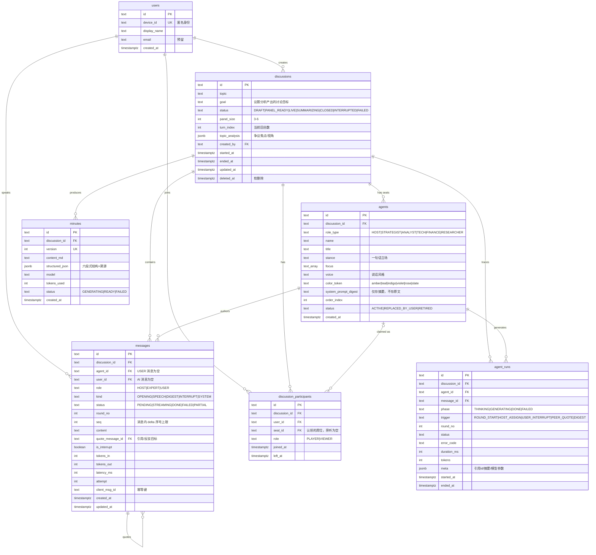
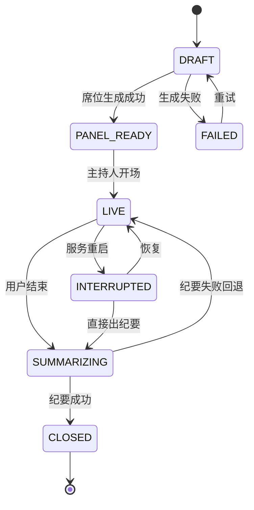

# 数据库设计 · AI Panel Studio

| 项 | 内容 |
| --- | --- |
| 版本 | v1.0 |
| 数据库 | PostgreSQL 16 |
| ORM | Prisma（`db/schema.prisma` 为准，本文档为设计说明） |
| 表数量 | 7（满足 ≥5 张表的硬性要求） |
| 命名约定 | 表名复数 snake_case；主键 `id`（cuid）；时间戳 `created_at / updated_at`（timestamptz） |

---

## 1. ER 图



---

## 2. 表设计说明

### 2.1 `users` — 用户（匿名优先，账号预留）

| 字段 | 类型 | 约束 | 说明 |
| --- | --- | --- | --- |
| `id` | text | PK | cuid |
| `device_id` | text | UNIQUE NOT NULL | 前端 localStorage 生成的匿名标识 |
| `display_name` | text | NOT NULL DEFAULT '旁听者' | 可在认领席位时改为自定义昵称 |
| `email` | text | NULL | 预留账号体系 |

> MVP 不提供登录。设备 ID 让"我参与的圆桌"可跨会话识别；后续接账号时按 `device_id` 合并。

### 2.2 `discussions` — 圆桌

| 字段 | 类型 | 约束 | 说明 |
| --- | --- | --- | --- |
| `topic` | text | NOT NULL, 8–200 字 | 用户输入的议题 |
| `goal` | text | NULL | 议题分析产出的"本场要回答的问题" |
| `status` | enum | NOT NULL DEFAULT 'DRAFT' | 见 §3.1 状态机 |
| `panel_size` | int | CHECK 3–6 | 1 主持 + (size-1) 专家 |
| `turn_index` | int | DEFAULT 0 | 已完成回合数 |
| `topic_analysis` | jsonb | NULL | `{ disputes[], audience[], angles[] }` |
| `created_by` | text | FK users | |
| `started_at` / `ended_at` | timestamptz | NULL | 用于统计时长 |
| `deleted_at` | timestamptz | NULL | 软删除 |

### 2.3 `agents` — 席位（含主持人）

| 字段 | 说明 |
| --- | --- |
| `role_type` | 枚举，决定默认立场模板与配色；`HOST` 唯一且 `order_index=0` |
| `stance` | 一句话立场，是"分歧"的载体，必填 |
| `focus` | `text[]`，2–4 个关键词，用于策略打分与上下文聚焦 |
| `voice` | 说话风格，注入 prompt |
| `system_prompt_digest` | **只存摘要**（如 sha256 前 16 位 + 200 字摘要），避免前端可读原始 prompt |
| `status` | `REPLACED_BY_USER`：用户认领后原 AI 席位；`RETIRED`：换一批时被替换 |

> 每个 `discussion_id` 下 `order_index` 唯一，保证席位顺序稳定（前端渲染与轨迹排序依赖它）。

### 2.4 `messages` — 消息（讨论的唯一事实流）

| 字段 | 说明 |
| --- | --- |
| `role` | `HOST` / `EXPERT` / `USER`，前端据此决定气泡样式 |
| `kind` | `OPENING` 开场、`SPEECH` 发言、`DIGEST` 主持人收束、`INTERRUPT` 用户插话、`SYSTEM` 系统提示 |
| `status` | `DONE` 正常；`FAILED` 生成失败可重试；`PARTIAL` 流中断但保留内容 |
| `round_no` | 所属回合，从 1 开始；`OPENING` 为 0 |
| `seq` | 该消息接收到的 delta 序号（用于前端去重/顺序） |
| `quote_message_id` | 引用/反驳目标；自关联，`ON DELETE SET NULL` |
| `is_interrupt` | 用户插话消息标记，调度器据此提升优先级 |
| `client_msg_id` | 前端 UUID，**幂等键**：`UNIQUE(discussion_id, client_msg_id)` |
| `attempt` | 重试次数，同一条重试沿用 `messageId`，`attempt+1` |

**为什么 delta 不落库**：单场 4 agent × 8 回合 × 约 300 delta ≈ 1 万次写；只在 `message.end` 写最终 `content` + `tokens_out` + `latency_ms`，写入量降到 1/300。

### 2.5 `minutes` — 会议纪要（版本化）

| 字段 | 说明 |
| --- | --- |
| `version` | 同一 discussion 内自增，`UNIQUE(discussion_id, version)` |
| `content_md` | 可直接复制/导出的 Markdown |
| `structured_json` | 六段式结构，每条要点带 `sourceMessageIds: string[]`，供溯源跳转 |
| `status` | `GENERATING` 允许前端先渲染骨架；失败保留上一版 |

`structured_json` 形状：

```json
{
  "topic": "…",
  "goal": "…",
  "claims": [{ "seatId": "…", "name": "陈立", "points": ["…"], "sourceMessageIds": ["m1","m7"] }],
  "disputes": [{ "question": "…", "sideA": { "seats": ["陈立"], "argument": "…", "sources": ["m7"] },
                 "sideB": { "seats": ["周敏"], "argument": "…", "sources": ["m9"] },
                 "unresolvedBecause": "缺少冷启动数据" }],
  "consensus": ["…"],
  "hypotheses": ["若 7 日内 CTR 提升 < 3%，则方案不成立"],
  "nextSteps": [{ "action": "…", "proposedBy": "周敏" }]
}
```

### 2.6 `agent_runs` — Agent 运行轨迹（可观测 + 前端轨迹面板数据源）

每次 LLM 调用一行。`phase` 从 `THINKING` 流转到 `GENERATING`、`DONE`/`FAILED`；`trigger` 记录"为什么说这句"，这正是 PRD FR-5 里"展开可见触发动机"的落地方式。

- 用于：轨迹面板回放、失败率统计、首 token 延迟分析、成本归因（按席位）。
- 不存 prompt 原文，只存 `meta`（引用 id、上下文摘要、模型与参数），避免数据泄漏与体积膨胀。

### 2.7 `discussion_participants` — 参与关系（认领/旁听）

- `PLAYER` 必须带 `seat_id`（认领了席位）；`VIEWER` 为 `NULL`。
- 约束：`UNIQUE(discussion_id, user_id)`（MVP 单用户单场一条），且 `seat_id` 在同一 discussion 内唯一（部分唯一索引，见 §4）。

---

## 3. 枚举与状态机

### 3.1 `discussion.status`



### 3.2 其余枚举

| 枚举 | 取值 |
| --- | --- |
| `agents.role_type` | `HOST` `STRATEGIST` `ANALYST` `TECH` `FINANCE` `RESEARCHER` |
| `agents.color_token` | `slate`(主持) `amber` `teal` `indigo` `violet` `rose` `emerald`(用户) |
| `messages.role` | `HOST` `EXPERT` `USER` |
| `messages.kind` | `OPENING` `SPEECH` `DIGEST` `INTERRUPT` `SYSTEM` |
| `messages.status` | `PENDING` `STREAMING` `DONE` `FAILED` `PARTIAL` |
| `agent_runs.phase` | `THINKING` `GENERATING` `DONE` `FAILED` |
| `agent_runs.trigger` | `ROUND_START` `HOST_ASSIGN` `USER_INTERRUPT` `PEER_QUOTE` `DIGEST` |

---

## 4. 索引与约束

| 表 | 索引/约束 | 目的 |
| --- | --- | --- |
| discussions | `(status, updated_at DESC)` | 大厅"进行中优先 + 按更新时间"排序 |
| discussions | `(created_by, updated_at DESC)` | "我参与的"筛选 |
| discussions | `topic gin_trgm_ops`（`pg_trgm`） | 议题关键词模糊搜索 |
| agents | `UNIQUE(discussion_id, order_index)` | 席位顺序稳定 |
| agents | `UNIQUE(discussion_id) WHERE role_type='HOST'` | 一场只能一个主持人 |
| messages | `(discussion_id, created_at)` | 按时间拉取消息流 |
| messages | `(discussion_id, round_no)` | 按回合聚合 |
| messages | `UNIQUE(discussion_id, client_msg_id)` | 幂等，防重复提交 |
| messages | `quote_message_id` | 溯源反查"谁引用了我" |
| minutes | `UNIQUE(discussion_id, version)` | 版本唯一 |
| agent_runs | `(discussion_id, started_at)` | 轨迹时间线 |
| agent_runs | `(agent_id, status)` | 单席位失败率统计 |
| participants | `UNIQUE(discussion_id, user_id)` | 单人单场一条 |
| participants | `UNIQUE(discussion_id, seat_id) WHERE seat_id IS NOT NULL` | 一个席位只能被一人认领 |

---

## 5. 初始化脚本

`db/init/001_schema.sql`（Docker 首次启动自动执行，同时被 Prisma migration 覆盖校验）

```sql
CREATE EXTENSION IF NOT EXISTS pg_trgm;
CREATE EXTENSION IF NOT EXISTS "uuid-ossp";

CREATE TYPE discussion_status AS ENUM
  ('DRAFT','PANEL_READY','LIVE','SUMMARIZING','CLOSED','INTERRUPTED','FAILED');

CREATE TABLE discussions (
  id          TEXT PRIMARY KEY,
  topic       TEXT NOT NULL CHECK (char_length(topic) BETWEEN 8 AND 200),
  goal        TEXT,
  status      discussion_status NOT NULL DEFAULT 'DRAFT',
  panel_size  INT  NOT NULL DEFAULT 4 CHECK (panel_size BETWEEN 3 AND 6),
  turn_index  INT  NOT NULL DEFAULT 0,
  topic_analysis JSONB,
  created_by  TEXT REFERENCES users(id) ON DELETE SET NULL,
  started_at  TIMESTAMPTZ,
  ended_at    TIMESTAMPTZ,
  created_at  TIMESTAMPTZ NOT NULL DEFAULT now(),
  updated_at  TIMESTAMPTZ NOT NULL DEFAULT now(),
  deleted_at  TIMESTAMPTZ
);

CREATE UNIQUE INDEX ux_host_per_discussion ON agents (discussion_id) WHERE role_type = 'HOST';
CREATE UNIQUE INDEX ux_participant_seat     ON discussion_participants (discussion_id, seat_id)
  WHERE seat_id IS NOT NULL;
CREATE UNIQUE INDEX ux_message_idempotency  ON messages (discussion_id, client_msg_id);
CREATE INDEX ix_messages_timeline           ON messages (discussion_id, created_at);
```

完整的建表语句（7 张表）与种子数据以 `db/init/002_tables.sql`、`db/seed.ts` 落地；Prisma schema 与之保持一一对应，`pnpm db:push` 可直接生成。

**种子数据**：1 个演示用户、1 场已结束的圆桌（含 4 席位 / 12 条消息 / 1 份纪要 / 8 条轨迹），用于 E2E 与本地开发时的"列表有内容"。

---

## 6. 数据生命周期

| 数据 | 保留策略 |
| --- | --- |
| 讨论与消息 | 永久（软删除 30 天后可清理） |
| agent_runs | 90 天（可按 discussion 归档） |
| minutes | 永久，保留全部版本 |
| 匿名 users | 无登录用户 180 天未活跃可清理（MVP 不做定时任务，仅记录策略） |

---

## 7. 与需求的对应关系

| 需求 | 落地方式 |
| --- | --- |
| ≥5 张表 | 7 张：`users` `discussions` `agents` `messages` `minutes` `agent_runs` `discussion_participants` |
| 观点溯源（FR-6） | `messages.quote_message_id` + `minutes.structured_json.sourceMessageIds` |
| 纪要落库可复盘（FR-7） | `minutes` 表版本化 + JSONB |
| 轨迹可回放（FR-5） | `agent_runs` 按 `discussion_id` 时间线查询 |
| 席位认领（FR-3） | `discussion_participants.seat_id` + 部分唯一索引 |
| 幂等与重试（FR-9） | `UNIQUE(discussion_id, client_msg_id)` + `messages.attempt` |
