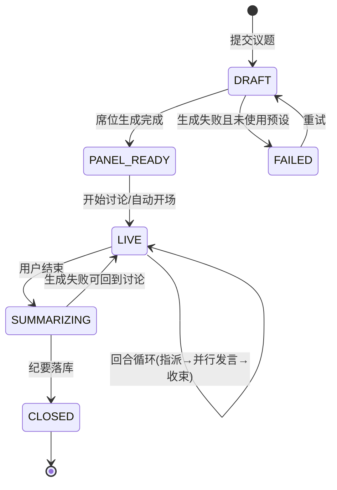
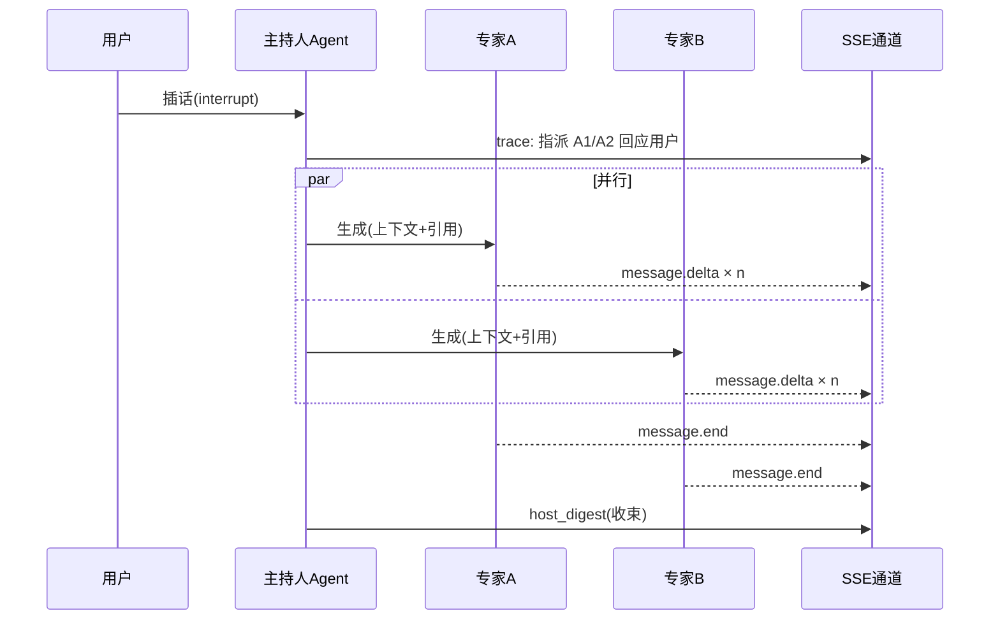

# PRD · AI Panel Studio（AI 圆桌讨论 Web App MVP）

| 项 | 内容 |
| --- | --- |
| 文档版本 | v1.1 |
| 状态 | 已实现（按代码现状同步） |
| 作者 | 待填（候选人） |
| 最后更新 | 2026-11-20 |
| 关联文档 | [ARCHITECTURE](ARCHITECTURE.md) · [DATABASE](DATABASE.md) · [API](API.md) · [TESTING](TESTING.md) |

**修订记录**

| 版本 | 日期 | 变更 |
| --- | --- | --- |
| v0.1 | 2026-11-17 | 从作业需求拆解出功能骨架 |
| v1.0 | 2026-11-17 | 补齐验收标准、状态机、非功能指标与降级策略 |
| v1.1 | 2026-11-20 | 同步五席位选座、开场前加入、纪要完成态与 5 条 E2E |

---

## 1. 背景与问题

### 1.1 一句话背景

单 AI 对话给的是**一个结论**；真实决策需要的是**几个立场互不相同的人吵完之后的判断**。

### 1.2 要解决的问题

| 现状痛点 | 具体表现 | 本产品的回应 |
| --- | --- | --- |
| **视角单一** | 一个模型一次只给一条主线结论，缺少对抗性，也缺少"被质疑"的过程 | 固定召集 3 位立场互补的专家，显式要求相互质疑 |
| **结构松散** | 追问靠用户自己组织，聊长了就散，缺少框架 | 主持人负责开场、串联、每两回合收束 |
| **无法沉淀** | 讨论散在长对话里，没法变成可复用素材 | 结束即产出按角色结构化的纪要，并落库可复盘 |
| **过程不透明** | 不知道 AI 为什么这么说，也不知道它是不是在编 | 每条观点标注发言人 + 轮次 + 触发来源，可跳回原文 |
| **体验呆板** | 一次性等一大段文本，等待期无反馈 | 多 Agent 并行流式，实时看到"谁在说话" |

### 1.3 为什么是"圆桌"而不是"多轮问答"

圆桌的价值在于**受控的对抗**：席位固定、立场固定、有主持人维持秩序。用户不是在对一个万能助手提问，而是在旁听/参与一场有观点冲突的会议。这决定了三个设计约束：

1. **席位有限且角色固定** —— 视角发散才有对比价值，不能让所有 agent 都变成"客观中立"。
2. **必须有主持人** —— 否则多 agent 会互相附和或无限跑题。
3. **必须能收束** —— 讨论的终点是一份可用的纪要，不是一堆聊天记录。

---

## 2. 产品定位

**「AI Panel Studio」** —— 一个人的随身智囊团。输入议题，召集一场 AI 圆桌，你可以旁听、可以插话、可以认领一个席位亲自下场辩论，最后由系统整理成一份带出处的会议纪要。

- **形态**：Web 应用（桌面优先，移动可用）
- **核心动作**：`提议题 → 组局 → 讨论 → 收敛成纪要`
- **不做的事**：不做通用聊天助手，不做单 agent 问答，不做 AI 播客生成

### 2.1 与替代方案的差异

| 方案 | 视角数量 | 有无对抗 | 过程可见 | 可复盘 |
| --- | --- | --- | --- | --- |
| 单 AI 对话 | 1 | 无 | 部分 | 弱 |
| 手动多开窗口问不同模型 | 2-3 | 需人工搬运 | 无 | 无 |
| AI 播客 / 双人对谈生成 | 2 | 脚本化，无真实分歧 | 无 | 弱 |
| **AI Panel Studio** | 3+ | 有（互相引用与反驳） | 有（行动轨迹） | 有（纪要 + 溯源） |

---

## 3. 目标用户与场景

| 用户群体 | 特征 | 典型场景 | 核心诉求 |
| --- | --- | --- | --- |
| 知识工作者 / 产品 / 研究 / 决策者 | 需要对议题形成有质量的判断，时间紧 | 立项评审前先"预演"一遍质疑；技术选型对比 | 几十分钟内拿到不止于问答的深度洞察与视角对比 |
| 内容创作者 / 市场 / 教育者 | 需要观点素材与结构 | 把一场圆桌整理成文章/课程提纲 | 可溯源、结构化的专家观点素材 |
| 学习者 | 想训练批判性思维 | 主动反驳专家，看对方如何回应 | 能"下场"参与而不是只看输出 |

### 3.1 主场景（Happy Path）

> 产品经理小林明天要过立项评审，议题是「我们该不该把推荐系统从规则引擎换成向量召回」。
> 她输入议题、选 5 人局，并先选一个自己的专家席位。系统给出主持人 + 战略顾问 + 行业分析师 + 技术专家 + 财务顾问，其余席位随后自动生成并开场。
> 她选了自己的「技术专家」席位，开场后战略顾问先讲投入产出，行业分析师拿出同类公司案例，她以技术专家身份反驳"冷启动阶段向量召回没数据"，AI 战略顾问立刻回击"那就先做影子流量"。两轮后主持人收束出三个分歧点。
> 她点结束，拿到纪要：三条核心分歧、各自论据、两条待验证假设，每条都能点回原话。

---

## 4. 范围

### 4.1 MVP 范围内

圆桌大厅、议题分析、专家面板生成、席位认领、多轮并行流式讨论、Agent 行动轨迹、观点溯源、结构化纪要、讨论管理与基础降级。

### 4.2 明确不做（Non-goals）

| 不做 | 原因 |
| --- | --- |
| 多用户同场实时协作（多人围观同一场） | 需要 presence/广播协议，超出 MVP；数据模型预留 `discussion_participants` |
| 完整账号体系（注册/登录/OAuth） | 用匿名身份（localStorage deviceId）+ `users` 表占位，可后续接 |
| 语音 / 数字人 / TTS | 与核心验证无关，成本高 |
| 知识库 / 联网检索 | 会让"专家观点"变成检索摘要，先验证讨论形态 |
| 移动端原生体验 | Web 响应式足够 |

### 4.3 术语

| 术语 | 定义 |
| --- | --- |
| 圆桌（Discussion） | 一场围绕单一议题的讨论实例，含席位、消息、轨迹、纪要 |
| 席位（Seat） | 一个 agent 在圆桌中的位置，绑定额定角色与立场；可被用户认领 |
| 回合（Turn） | 一次「主持人指派 → 专家并行发言 → 主持人收束」的完整循环 |
| 轨迹（Trace） | agent 的行为事件流：思考中 / 生成中 / 完成 / 失败 |
| 纪要（Minutes） | 讨论结束后按角色聚合的结构化结论（JSON + Markdown，落 SQLite `TEXT` 字段） |
| 引用（Quote） | 一条消息对另一条消息的显式指涉（反驳/补充/质疑） |

### 4.4 技术栈（项目既定约束）

| 层 | 选型 | 约束性质 |
| --- | --- | --- |
| 后端 | **Spring Boot 3.5.16**（Spring MVC + `SseEmitter`） | 既定，不可替换 |
| 语言/运行时 | **JDK 17（LTS）** | 既定，不可替换 |
| 前端 | **Vue 3.4** + TypeScript + Vite 5 | 既定，不可替换 |
| 数据库 | **SQLite 3.40+**（WAL 模式） | 既定，不可替换 |
| 数据访问 | MyBatis-Plus 3.5.12 + Flyway 11 | 按 SQLite 特性补齐（显式不用 MyBatis 原生 / 不用 JPA） |
| UI | **Vue 3 单文件组件 + 原生 CSS**（设计令牌），界面全中文 | 组件与样式由项目组织，便于按圆桌场景控制三色区分、信息密度与滚动区域 |
| 运行方式 | **本地原生运行，不使用 Docker / 容器 / nginx** | 既定；开发用 Maven + Vite，演示用单个 `java -jar` |

由此产生的产品侧影响（不是纯技术细节，PRD 必须显式写）：

1. **流式体验依赖 SSE + 单连接多路复用**：前端必须自己解析 `ReadableStream`（`EventSource` 无法携带设备标识），因此断线重连与"恢复中"提示是产品需求，不是可选项（见 FR-9）。
2. **SQLite 是单写者**：落库必须"消息结束才写一次"，这决定了前端只能拿到**最终态**的持久化承诺 —— 流式中断的内容标记为"可能不完整"（FR-9），而不是假装已保存。
3. **无虚拟线程（JDK 17）**：每场最多 3 位专家同时发言是**产品约束也是技术约束**（FR-4 的 K=2~3），不是随便定的体验数字。
4. **不使用容器**：交付以 `scripts/dev` 与 `java -jar` 为准，README 需给出可复现的本地启动步骤与数据文件位置。
5. **与作业原文的差异需在 README 说明**：作业附件提到 "Docker Compose 一键起来"，本项目按当前约定改为本地脚本启动，需在交付说明中明确写出这一差异及理由（SQLite 无独立服务，容器只会增加一层流式代理风险）。
6. **后端语言与作业推荐不同**：作业技术要求写的是"后端基于 Node.js 生态环境和 TypeScript（**推荐**）实现"。本项目按既定技术栈用 Spring Boot 3.5.16 + JDK 17 —— 属推荐项而非强制项。需要在交付说明中论证：多 Agent 调度、并行流式、错误隔离这三个考核点与语言无关；且 JDK 17 无虚拟线程，线程池 / 信号量 / 写锁串行化都必须显式设计，反而更能体现工程判断（见 ARCHITECTURE §3.4）。

### 4.5 作业功能要求与本 PRD 的对应

| 作业「功能要求」 | 本 PRD 条目 |
| --- | --- |
| 圆桌：展示所有进行中的讨论，可加入已有讨论，也可发起新讨论 | FR-1 |
| 论坛：输入议题后生成 N 位专家角色，用户可自选加入 | FR-2 + FR-3 |
| 圆桌主持：主持人开场、串联、不强行拉回主题 | FR-4 |
| 观点与叙事：实时呈现 Agent 行动轨迹，不曝光整套流程 | FR-5 |
| 多轮自由讨论：随时加入、发言、追问、质疑，不限轮次 | FR-4 |
| 观点溯源与总结：可查每条观点的 agent 与轮次 | FR-6 |
| 总结：按角色提炼观点，结构化纪要 + JSON 入库 | FR-7 |
| （工程侧）错误兜底、可观测、可测试 | FR-9 + 本文 §9 |

---

## 5. 功能需求

优先级：`P0` 必须交付 · `P1` 应该交付 · `P2` 可选。

### FR-1 圆桌大厅（P0）

**描述**：展示所有圆桌，支持旁观、加入与发起新议题。

**交互细节**

- 卡片信息：议题（最多 2 行截断）、状态徽标（进行中 / 已结束）、`已进行 N 回合`、席位头像组（含"你"标记）、最后一条发言摘要 + 发言人、相对时间。
- 排序：进行中优先，其次按 `updated_at` 倒序。
- 筛选：全部 / 进行中 / 我参与的 / 已结束；顶部关键词搜索（议题模糊匹配）。
- 发起入口：右上「+ 发起圆桌」→ 弹层输入议题（8–200 字，实时字数）→ 选参会人数（3–6，默认 5，即 1 主持 + 4 专家），可先选一个专家席位 → 「召集专家」。
- 状态处理：加载骨架屏、空态（引导发起第一场）、失败态（重试按钮 + 错误原因）。

**验收标准**

- [ ] 首屏列表在 20 条数据下 P95 < 800ms。
- [ ] 新建成功后 300ms 内进入详情页，并进入「专家生成中」态。
- [ ] 议题少于 8 字时提交按钮禁用并提示原因。
- [ ] 列表为空时展示引导，而不是空白页。

### FR-2 议题分析与专家生成（P0）

**描述**：把用户的一句话议题，扩展成一场有结构的圆桌。

**两阶段流程**

1. **议题分析**（一次性结构化输出）：争议焦点、讨论目标、需要覆盖的 3–4 个视角、建议的专家类型。
2. **席位生成**（流式，逐个席位返回）：主持人 + N 位专家。

**席位字段**

| 字段 | 说明 |
| --- | --- |
| `name` | 中文姓名式称呼（如「陈立」），避免"专家A"这种占位感 |
| `title` | 岗位/身份（战略顾问 / 行业分析师 / 技术专家 / 财务顾问 / 用户研究员） |
| `stance` | 一句话立场，必须与其他席位构成张力（如"先算清 ROI 再谈技术"） |
| `focus` | 2–4 个关注点关键词，用于发言时聚焦 |
| `voice` | 说话风格（简短犀利 / 数据驱动 / 举例类比） |
| `colorToken` | 视觉标识：`amber` / `teal` / `indigo` / `violet` / `rose` |

**交互细节**

- 席位卡片逐张浮现（每张到达即渲染，不等待全部完成），首张目标 < 3s。
- 「换一批」：重新生成未认领的席位，最多 2 次（防刷成本）。
- 生成失败：明确错误文案 + [重试] + [使用预设阵容]（内置 3 套模板，离线可继续）。
- 生成方式：用户先选一个专家席位，点「生成其他席位并开始」后由 AI 补齐其余席位并自动开场；也可选择「全部交给 AI」。
- 其他用户可在 `DRAFT` / `PANEL_READY` 阶段进入组局页认领专家席位；发起人不等待时，未认领席位由 AI 担任。

**验收标准**

- [ ] 5 人局 P50 生成耗时 ≤ 8s，且阵容中至少两位立场存在可识别的对立。
- [ ] 生成中途离开页面不产生半截脏数据（席位写入在生成完成后一次性落库，或按 `status=DRAFT` 隔离）。
- [ ] 失败后重试不会重复创建席位（幂等）。
- [ ] 用户选定席位后，其余席位由 AI 生成，生成完成即开场，无需再点第二次。

### FR-3 席位认领与旁听（P0）

**描述**：用户可选择"下场"或"旁观"。"下场"既可以在生成前选座，也可以在开场前认领。

- 选座：用户先选一个专家角色，服务端按固定席位方案保留该席位（`REPLACED_BY_USER`），其余席位由 AI 生成。
- 认领：席位卡「我来坐这里」→ 该席位 `claimed_by_user_id` 落库，头像替换为「你」，其历史 AI 发言保留并标 `superseded_by_user`。
- 撤销认领：恢复为 AI 席位，AI 重新接管（不删历史）。
- 旁听：直接进入讨论；旁听用户发言进入「旁听席」，由主持人点名回应。
- 单场仅允许一个用户席位（MVP 约束）。
- 认领窗口：`DRAFT` / `PANEL_READY`；讨论已 `LIVE` 后返回 `409 ALREADY_STARTED`，避免已生成发言的说话人对不上。
- 被用户接手的席位不再由 AI 选为发言人；未认领席位在开场后继续由 AI 担任。

**验收标准**

- [ ] 认领后前端 200ms 内完成视觉切换（头像/输入框占位文案/席位标识）。
- [ ] 刷新页面后认领状态保持（服务端为准）。
- [ ] 同一席位重复认领请求返回 `409 SEAT_TAKEN`。
- [ ] 开场后再认领返回 `409 ALREADY_STARTED`。

### FR-4 圆桌讨论（P0，核心）

**描述**：多轮、并行、可插话的流式讨论。

**回合规则**

1. **开场**：主持人一次性输出：议题复述（1 句）、本场目标、席位介绍（每人 1 句）。不重复用户原文超过 30 字。
2. **发言**：主持人指派本轮发言者（可由规则引擎决定：未发言者优先 / 被引用者优先 / 被用户点名者优先）。同回合内 2–3 位专家**并行**发言。
3. **互评**：专家发言可引用他人消息（`quoteMessageId`），要求"先回应再主张"，禁止纯附和。
4. **收束**：每 2 回合由主持人产出小结（分歧点 / 新出现的信息 / 下一轮焦点），小结不落为"专家发言"，单独 `kind=host_digest`。
5. **用户插话**：任意时刻可发言；系统把用户消息标记 `interrupt=true`，下一轮优先由 1–3 位相关专家响应。
6. **结束**：用户点「结束讨论」→ 停止调度 → 进入纪要生成。

**并行与流式的产品约束**

- 多个 agent 同时输出时，消息**按开始顺序占位**，各自独立渲染，不因某个 agent 慢而阻塞其他人的显示。
- 每个消息卡片有独立状态：`thinking → streaming → done / failed`。
- 单 agent 失败：该卡片显示「发言中断 · 重试」，其余继续；主持人收束时用一句"某位嘉宾暂时离席"衔接，不打断体验。
- 用户滚动离开底部时，不强制自动滚动（显示「有 N 条新发言 ↓」浮标）。

**验收标准**

- [ ] 同回合 3 位专家并行时，各自首 token 互不阻塞（任一慢请求不延迟其他消息渲染）。
- [ ] 无轮次上限；连续 10 回合后上下文不溢出（触发滚动摘要压缩）。
- [ ] 用户插话后，下一轮至少有 1 位 agent 显式回应用户内容（而非自说自话）。
- [ ] 单 agent 超时/报错时，其余 agent 与整场讨论仍可正常进行与结束。

### FR-5 Agent 行动轨迹（P0）

**描述**：让用户看到"谁在做什么"，但不说破内部实现。

- 时间线事件：`思考中` → `生成发言` → `完成`（含耗时/字数） / `失败`。
- 每条事件显示触发来源：`由主持人指派` / `回应用户` / `回应 @某专家` / `首轮开场`。
- **默认折叠**技术细节；展开可见：触发动机、引用的消息、耗时、token 消耗。
- 与消息流联动：点击轨迹条目滚动定位到对应消息；点击消息高亮其轨迹。
- 空窗处理：所有 agent 空闲时显示"等待主持人推进"。

**验收标准**

- [ ] 任一时刻，7 个 agent 状态与实际消息流一致（可用 E2E 断言状态文本）。
- [ ] 轨迹事件落库（`agent_runs` 表），讨论结束后可回放。
- [ ] 默认视图不出现 prompt、token 等原始技术字段。

### FR-6 观点溯源（P0）

**描述**：每条观点可查出处。

- 消息卡片元信息：发言人 + 身份 + 第 N 回合 + 时间 + 引用徽标（`↩ 回应 @陈立`）。
- 点击引用徽标 → 滚动到被引用消息并高亮 1.5s。
- 纪要页的每条要点带 `sourceMessageIds`，点击跳转详情页并定位。

**验收标准**

- [ ] 纪要要点跳转原文成功率 100%（含跨页跳转）。
- [ ] 被引用消息已删除/不存在时显示「原发言已不可用」，不报错、不白屏。

### FR-7 会议纪要（P0）

**描述**：讨论的最终交付物。

**结构（固定六段）**

1. **议题与目标**（1–2 句）
2. **各方核心主张**（按席位分组，每人 2–4 条，每条带 `sourceMessageIds`）
3. **分歧点**（≥1 组，格式：分歧内容 / A 方论据 / B 方论据 / 当前未决原因）
4. **已达成的共识**
5. **待验证假设**（可执行、可检验的表述）
6. **建议下一步**（1–3 条，标注提出者）

**交互与数据**

- 生成过程流式呈现（分节到达，已到达的段先渲染）。
- 生成完成后写入 `minutes` 表（`content_md` + `structured_json`），重复生成产生新版本（`version` 自增），默认展示最新且可切换历史版本。
- 支持复制 Markdown；讨论未结束时不可生成"正式纪要"，但可生成「阶段性小结」。

**验收标准**

- [ ] 刷新/换设备重新打开纪要，内容一致（来自数据库而非前端缓存）。
- [ ] 纪要中至少 80% 的要点能溯源到具体消息。
- [ ] 生成失败可重试，且不覆盖上一版成功纪要。

### FR-8 讨论管理（P1）

- 结束讨论（二次确认，结束即停止调度并关闭 SSE）。
- 同议题「再来一场」（复制议题与席位配置，新建 discussion）。
- 删除（软删除 `deleted_at`，仅创建者可见入口）。

**验收标准**：结束后 3s 内所有 SSE 连接关闭，不再产生新消息；软删除后不出现在列表，但直链访问返回 410。

### FR-9 异常与降级（P0）

| 场景 | 产品表现 |
| --- | --- |
| 首 token 超时（45s） | 消息卡片转 `failed`，提供单条重试；连续 2 条失败则提示「模型服务不稳定」并给出稍后重试入口 |
| 限流 / 额度不足（429 / 402） | 顶部横幅说明原因 + 暂停调度，不丢失已有内容 |
| SSE 断线 | 自动重连（指数退避，最多 3 次），携带 `Last-Event-ID` 续传；期间顶部显示「连接中断，正在恢复」 |
| 生成内容不合法（JSON 解析失败） | 服务端修复 1 次（重新请求 + 严格 schema），仍失败则该席位降级为预设模板 |
| 数据库写失败 | 消息保留在内存队列并按 500ms 重试 3 次；仍失败则前端提示「本条可能未保存」 |

---

## 6. 关键流程

### 6.1 圆桌状态机

### 6.2 单回合时序（详见 ARCHITECTURE）

---

## 7. 信息架构与页面

| 路由 | 页面 | 主要内容 |
| --- | --- | --- |
| `/` | 圆桌大厅 | 列表、筛选、搜索、发起入口 |
| `/discussions/:id` | 圆桌现场 | 席位栏 + 讨论流 + 轨迹面板 + 输入区 |
| `/discussions/:id/minutes` | 会议纪要 | 结构化纪要、版本切换、溯源跳转、导出 |
| `/discussions/:id/panel` | 组局页 | 议题分析 + 先选座 + 席位生成 + 开场前认领 |

> MVP 至少交付 3 个路由；组局页可作为 `/` 的弹层阶段实现，独立路由更利于刷新恢复（推荐保留）。

---

## 8. 交互与视觉规范

- **布局与滚动（硬性约束）**：**不依赖整页滚动**。根容器固定视口（`100dvh` + `overflow: hidden`），三个区域各自是独立滚动容器，互不影响：
  - 席位栏 `overflow-y:auto`；
  - 讨论流 `overflow-y:auto`（新发言只让该容器滚到底；用户上滑阅读时不强制跟随，显示「有 N 条新发言 ↓」）；
  - 轨迹栏 `overflow-y:auto`（与讨论流各滚各的）；
  - 输入区固定在底部，不随任何容器滚动。
- **四档分配**：

  | 断点 | 布局 | 要点 |
  | --- | --- | --- |
  | ≥1920px（超宽屏） | 席位 260 / 讨论流自适应（限宽 960 居中）/ 轨迹 360 | 讨论流限宽，避免长行难读；两侧留白不拉伸 |
  | 1280–1919px | 三栏 240 / 自适应 / 320 | 默认桌面形态 |
  | 768–1279px | 两栏：席位 220 / 讨论流；轨迹改抽屉（覆盖层，自身滚动） | 平板 |
  | <768px | 单栏：顶部席位横向滚动条 / 中部讨论流 / 底部输入固定；轨迹为全屏抽屉 | 手机 |

- **三色识别**：战略顾问 `amber`、行业分析师 `teal`、技术专家 `indigo`；主持人中性 `slate`；用户席位 `emerald`。颜色同时用于头像边框、消息左边条、轨迹点。
- **席位栏**：头像 + 姓名 + 岗位 + 实时状态点（呼吸动画=生成中）。
- **消息卡**：左侧色条 + 头像 + 姓名/岗位 + 轮次徽标 + 正文（流式打字机，rAF 节流，避免抖动）+ 底部引用与其他操作。
- **可访问性**：全部操作键盘可达；正文对比度 ≥ 4.5:1；流式输出使用 `aria-live="polite"` 且节流，避免读屏炸屏。
- **动效**：席位生成 240ms 淡入上移；流式光标闪烁 1s；不使用炫技动画（讨论场景重内容）。

### 8.1 全中文界面规范

- **语言**：界面文案 100% 简体中文，不出现 `OK / Cancel / Submit / Loading / No Data` 这类默认英文；文案集中放在 `lib/copy.ts`，前后端术语同源。
- **术语统一**：圆桌 / 议题 / 席位 / 认领 / 回合 / 发言 / 插话 / 轨迹 / 纪要 / 溯源 / 收敛。换词即视为 bug（例如"会议"与"圆桌"混用）。
- **时间**：相对时间优先（刚刚 / 3 分钟前 / 昨天 16:32）；绝对时间 `2026-11-17 16:32`，24 小时制。
- **数字**：中文与数字间留空格（"3 个席位"、"第 2 回合"）。
- **错误文案**：必须"原因 + 下一步"，如「模型服务超时，已保留已生成内容，可重试」；禁止只写"出错了"。
- **空态**：一句解释 + 一个动作（「还没有圆桌，发起第一场？」），不用英文插画占位。
- **字体**：`-apple-system, "PingFang SC", "Microsoft YaHei", "Source Han Sans SC", sans-serif`；正文 15/1.7，讨论流最大行宽 720px。
- **UI 实现方式**：**Vue 3 单文件组件 + 原生 CSS 变量**（`styles/tokens.css` 承载三色、间距、字号与中文字体栈），组件按业务语义拆分。

---

## 9. 非功能需求

| 维度 | 指标 |
| --- | --- |
| 性能 | 大厅接口 P95 < 800ms；首 token P50 < 2.5s；同一回合 3 路并行首 token 差值 < 1s |
| 并发 + **多讨论隔离** | 单实例稳定承载 20 场 × 4 agent（约 80 路 SSE），CPU < 60%；不同讨论的**状态 / 事件流 / transcript / 共识与分歧**互不串台（见 ARCHITECTURE §3.10） |
| 数据一致性 | 消息流结束后 500ms 内落库；纪要生成在单事务内写入 |
| 可观测 | 结构化日志（`discussionId` / `turnId` / `agentId` / `latency`）；`/api/health` 探活；`agent_runs` 全量留痕 |
| 安全（密钥边界） | **大模型 API Key 只存在于后端**，从环境变量读取（`LLM_API_KEY`）；前端、构建产物、日志中均不得出现；`.env` 不入库；前端只能调用本项目的 `/api`，不直连模型厂商 |
| 可测试 | 5 条 E2E 主链路 + 降级/隔离用例；LLM 可 Mock（录制/回放）以便离线跑测 |
| 兼容 | Chrome / Edge 最新两个大版本；Safari 17+；布局适配 ≥1920 / 1280–1919 / 768–1279 / <768 四档 |

---

## 10. 度量

| 指标 | 定义 | 目标 |
| --- | --- | --- |
| 讨论完成率 | 结束并成功产出纪要的场次 / 创建场次 | ≥ 60% |
| 用户参与率 | 有至少 1 条用户发言的场次占比 | ≥ 35% |
| 平均回合数 | 每场结束时的回合数 | 4–8 |
| 首 token 延迟 | 提交到首个 delta 到达 | P50 < 2.5s |
| Agent 失败率 | failed 消息 / 总消息 | < 3% |
| 单场成本 | 单场累计 token | 记录并按议题长度分档 |

---

## 11. 风险与对策

| 风险 | 影响 | 对策 |
| --- | --- | --- |
| 专家互相附和、无真实分歧 | 产品价值归零 | 席位 prompt 强绑定立场；发言需"先反驳/补充再主张"；主持人收束时点名未表态方 |
| 抢话、复读、跑题 | 体验混乱 | 单回合发言配额（≤3 人）；引用约束；主持人每 2 回合拉回焦点 |
| 上下文膨胀 / 成本失控 | 长讨论不可用 | 滚动摘要（前 N 回合压缩为摘要）+ 最近 6 条原文；单场上限告警 |
| SSE 被代理缓冲 | 流式变"一次性吐出" | 关闭 `X-Accel-Buffering`、禁用压缩、15s 心跳注释帧 |
| 并行渲染抖动 | 视觉不稳 | 消息按开始顺序固定槽位；delta 用 rAF 批量提交；打字机限速 |
| 只有"能跑"没有"可验收" | 评分失分 | 每条 FR 带验收标准，E2E 覆盖主链路（见 TESTING） |

---

## 12. 里程碑与交付物

| 阶段 | 产出 |
| --- | --- |
| M0 文档 | PRD / 架构 / ER / API / 测试设计 / 计划 / 留痕模板 |
| M1 骨架 | Maven + Spring Boot 3.5.16 工程、Flyway 迁移建 7 张表（SQLite）、Vue 3 工程骨架、`/api/health`、结构化日志与统一异常处理 |
| M2 组局 | 议题分析 + 席位生成（流式）+ 用户选座 + 自动开场 + 开场前认领 |
| M3 讨论 | Orchestrator、并行流式、SSE 多路复用、轨迹 |
| M4 收敛 | 纪要生成与落库、参会信息、溯源跳转、下载 Markdown |
| M5 质量 | 5 条 E2E、降级用例、README/架构图/API 文档定稿、录制演示视频 |

交付物：源码（含 Git 历史 ≥ 30 次提交）+ 文档 + 3–5 分钟演示视频 + README（运行 / 架构 / AI 使用说明）。
交付清单、压缩包结构、视频分镜、邮件模板与评分维度自检见 [DELIVERY.md](DELIVERY.md)。

---

## 13. 开放问题

1. 用户认领席位后，原 AI 的历史发言是否应该"接管"（以用户身份重述）？当前选择：保留 AI 发言并标注，避免篡改历史。
2. 是否允许用户同时开多场圆桌？MVP 允许（无状态限制），但 UI 只高亮最近一场。
3. 纪要的"分歧点"由模型归纳容易漏，是否需要二次校验（用另一轮调用检查引用有效性）？倾向 P1 做。
